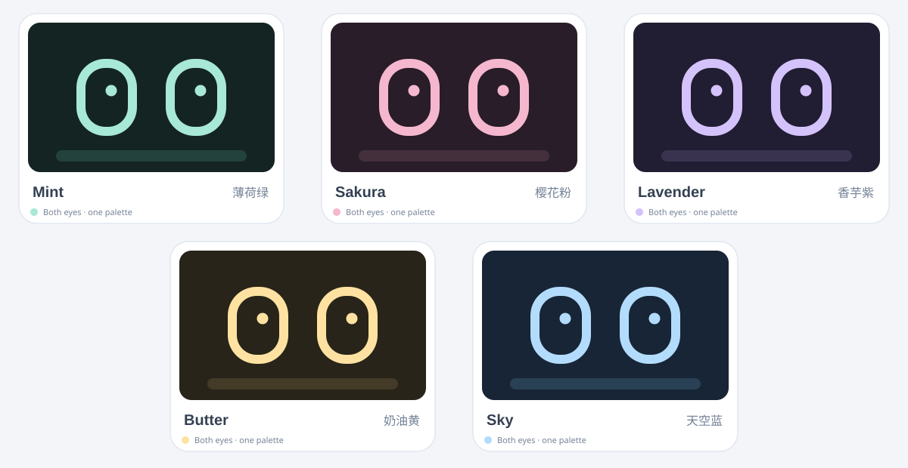

# esp-bot

**小呆 (Xiao Dai)** — a quiet, passive desktop companion built around ESP32-S31-Korvo-1. Local gaze, wake and behavior stay independent of Mac availability; the Rust/Tauri Mac Brain coordinates OpenCode, local speech, identity and memory. The only production voice wake phrase is **小呆小呆**, a single continuous four-syllable keyword. A standalone **小呆** must never wake the device.

> Hardware target is **ESP32-S31-Korvo-1 V1.1** (ESP32-S31), **not** ESP32-S3-Korvo-1. The S31 board has an 800×480 RGB display and GT1151 touch panel. Use ESP-IDF 6.1 / `esp32s31`, not `esp32s3`.

## Mac bot-server source delivered — 2026-11-06

**[Mac 端完整接入与准备指南](docs/mac-bot-server.md)** is the current server implementation record. The existing Tauri app now has a Chinese companion console, native **OpenCode 2.2.5** harness, ordered **Qwen Coding Plan → GLM Coding Plan → DeepSeek Flash** routes, inherited browser/search MCP, local Whisper ASR/system TTS, enrolled face/speaker recognition and SQLite memory.

The Mac WSS v3 endpoint and credential management are written. **The firmware WSS client is still pending; the old LAN link remains diagnostic.** No tests, compilation, dependency installation, model inference, paid API calls or CI were run. Hardware has not arrived. Start with the Mac guide; it distinguishes source integration from remaining setup and device work.

## Local runtime source delivered — 2026-11-06

**[本地 Runtime 实现与接入指南](docs/local-runtime.md)** is the current implementation record. `app_main` now composes the local behavior runtime, bounded bus, official ESP-SR audio adapter, official esp_video/ESP-DL camera adapter, one focus manager, stationary gaze, Face/touch/stop UI, and an optional LAN diagnostic boundary. The legacy HTTP poller is no longer started or built by main.

**Hardware has not arrived. This delivery was not compiled, tested, flashed, or run; no CI was added.** The dedicated **小呆小呆** acoustic model remains unprovisioned. On-device face detection/landmarks do not identify family members or estimate human gaze. Mac speech/harness/identity source is now integrated separately; secure firmware media and BLE provisioning remain subsequent work.

## New project direction: reuse-first + Mac-first (2026-10-30)

**小呆 prioritizes mature open-source modules rather than recreating audio, media, hardware or inference stacks.** Our **M4 Pro / 48 GB Mac with Rust/Tauri `server/bot-server`** is the primary AI host. The latest user selection uses OpenCode and the three model routes above; speech, embeddings and memory stay local. Secure Wi-Fi plus **Bluetooth (BLE) provisioning/control fallback** remain the device transport target. **All device-local wake/behavior stays independent of Mac availability.**

The **new physical target** is a good-looking enclosed **pan/tilt** head with integrated external loudspeakers using off-the-shelf mechanical parts. The *current* physical prototype remains unactuated until hardware has been chosen/installed. Korvo-1 already has **two integrated 3 W speaker amplifiers**; select compatible speakers and wiring rather than another audio amplifier.

- **[Local-First Hybrid Brain: canonical new deployment + BLE fallback](docs/local-first-hybrid-brain.md)**
- **[Upstream reuse catalog: verified project links, ports, licenses, adoption priorities](docs/upstream-reuse-catalog.md)**
- **[Off-the-shelf hardware shortlist: official Korvo shell STL/STEP, pan/tilt kits and speakers](docs/off-the-shelf-hardware.md)**
**精确型号/打印文件与采购顺序：** [3D 打印 + 扬声器 + 云台 + 电源 BOM V2](docs/print-files-and-bom-v2.md)（含制造商、型号、数量、渠道、STL/STEP、兼容风险与装配示意要求）。

- **[Current system authority / behavior architecture](docs/architecture.md)**

**Status:** The device runtime and official peripheral adapters now have source integration. No claims of compiled firmware, BLE, working local Mac speech, motor assembly or production secure pairing.

## Identity and wake-word policy

The robot is named **小呆** (Xiao Dai). Its **only production wake phrase is 小呆小呆**, recognized as one complete four-syllable on-device keyword. A single 小呆 must not wake it. Night mode leaves the local audio owner running. See [wake-word specification](docs/wake-word.md) and [shared identity manifest](shared/bot-identity.json). **WakeNet integration is written; the dedicated model is not provisioned and the pipeline is not hardware-validated.** Missing resources report `WAKE_MODEL_MISSING`; deliberate touch remains the manual entry point.

## System decisions and authoritative documents

**Initial target configuration:** fixed, non-actuated head/camera; **hardware is still awaiting delivery, with no installed IMU or pan/tilt**. The stationary adapter reports no measured head pose. Screen eyes use the selected person's current camera-relative eye midpoint; software cannot mechanically re-aim a fixed camera after the person leaves the image. Future pan/tilt and optional IMU use replaceable adapters.

**Behavior V1:** idle → bored → drowsy → asleep, optional night policy; no spontaneous greetings or wake from faces/room chatter. Only the complete **小呆小呆** model event or deliberate touch starts engagement. Passive/night states pause camera capture/inference while keeping local audio alive. This BSP cannot control LCD brightness, so the implemented display fallback is a logical black overlay with active touch, not physical backlight-off.

The canonical system ownership specification is **[docs/architecture.md](docs/architecture.md)**, with deployment/provider/Bluetooth policy in **[docs/local-first-hybrid-brain.md](docs/local-first-hybrid-brain.md)**. Related ownership-specific sources:

| Document | Owns |
| --- | --- |
| [Module contracts and bot_bus](docs/module-contracts.md) | bot_runtime/bot_bus, events, latest snapshots, permissions, freshness |
| [Passive behavior and night lifecycle](docs/behavior-lifecycle.md) | Idle, bored, drowsy, sleeping, night dark, waking, conversation |
| [Wake phrase 小呆小呆](docs/wake-word.md) · [identity manifest](shared/bot-identity.json) | Only wake phrase, offline audio, model resource and negative cases |
| [Eye–head coordination / visual follow](docs/eye-contact.md) | V1 fixed-camera visual correction, future motors and IMU |
| [Multi-face visual perception](docs/visual-attention.md) | Eye landmarks, pupils, uncertainty, per-person gaze/track time |
| [Two-mic acoustic DOA](docs/audio-direction.md) | Sound bearing hints and front/back ambiguity; not a wake engine |
| [Hardware / sensor / power](docs/hardware-power.md) | Real S31 capability, camera exposure, display sleep limits |
| [Implementation roadmap](docs/implementation-roadmap.md) | Existing versus planned code, integration order and disclosure |
| [Local runtime implementation](docs/local-runtime.md) | Actual startup, official adapters, dependencies, partitions, model preparation and Mac boundary |
| [Mac bot-server](docs/mac-bot-server.md) · [OpenCode](docs/mac-opencode.md) | Native v2 harness, model routing, tools, parent console and installation |
| [Mac companion console](docs/mac-console.md) | Explicit recording/camera, reply cards, family management and one-time tool approval |
| [Local models](docs/mac-local-models.md) · [Memory](docs/mac-memory.md) | Official ASR/TTS/identity adapters, explicit enrollment and scoped memory |
| [Authenticated Mac gateway](docs/mac-gateway.md) · [WSS v3 contract](shared/mac-brain-v3.md) | Mac TLS/media endpoint; firmware client remains pending |
| [Appearance design](docs/face-design.md) · [LAN discovery](docs/lan-discovery.md) | UI/Face and existing isolated link architecture |

**No CI:** this project is code-first; do not create CI workflows or block implementation on unavailable test hardware. Report build/device verification honestly (see [AGENTS.md](AGENTS.md)).

## Repository layout

| Path | Responsibility |
| --- | --- |
| `firmware/` | Integrated ESP-IDF local runtime using the official S31 BSP; no legacy HTTP polling in main |
| `firmware/components/bot_runtime/` · `bot_bus/` | Local behavior/session authority, cancellation and bounded task communication |
| `firmware/components/bot_audio/` · `bot_vision/` | Official ESP-SR/codec and esp_video/ESP-DL adapters |
| `firmware/components/bot_platform/` · `head_motion/` | Board resource support and honest stationary hardware capabilities |
| `firmware/components/attention_manager/` | One selected focus with dwell, hysteresis and visual-loss handling |
| `firmware/components/face/` | Reusable expression controller, pluggable eye renderers, subtitles and Settings -> Appearance UI |
| `firmware/components/attention/` | Independent eye-contact geometry: shared gaze direction, head setpoints and confidence gating |
| `firmware/components/vision_attention/` | Multi-face tracking core fed by bot_vision; pupil candidates remain separate from actual human-gaze evidence |
| `firmware/components/brain_link/` · `lan_link/` | Optional Wi-Fi discovery/diagnostic WS; rejects untrusted remote control |
| `server/` | Legacy Python prototype and selected Rust/Tauri `bot-server`: OpenCode routes, local models, memory/identity, Chinese console and Mac WSS v3 |
| `shared/` | Canonical theme tokens and documented JSON/HTTP contract |
| `preview/` | Browser-based interactive face preview; no board required |
| `tools/` | Generate firmware color header from the shared theme JSON |
| `docs/` | Design rules, integration and staged roadmap |

## Theme gallery



## Quick start

### Face preview (first)

From the repository root:

```sh
python3 -m http.server 8765 --bind 127.0.0.1
# open http://127.0.0.1:8765/preview/
```

Touch the simulated screen to show the corner gear (auto-hides after five seconds). Open **Settings → Appearance**, select one of the five installed pastel appearances (mint/sakura/lavender/butter/sky), then press **Apply** to return to the face. Selection does nothing until Apply, and the preview persists the choice in localStorage. All five shipped styles share an outline renderer; future appearance packs can choose entirely different eye geometries, assets and motion profiles. Use the debug panels below the screen to test expressions, gaze direction and subtitles.

### Legacy Brain server (Python 3.10+, isolated prototype)

```sh
cd server
python3 -m espbot
# http://127.0.0.1:8766/health
```

No third-party Python dependencies for this historical prototype. See [server/README.md](server/README.md). The current firmware entry point no longer polls it. Use [server/bot-server](server/bot-server/README.md) for the selected Mac implementation; firmware-side WSS media integration is still pending.

### Firmware (S31 board)

These are **future setup commands**, not commands executed for the current source-only delivery. Use Espressif **ESP-IDF 6.1+ with ESP32-S31 support**, then:

```sh
cd firmware
idf.py set-target esp32s31
idf.py menuconfig  # ESP Bot + Xiaodai local audio/vision/runtime options
idf.py build
idf.py -p /dev/ttyACM0 flash monitor
```

Local policy, touch and perception adapters do not require a Brain connection. Read [model/partition preparation and current limitations](docs/local-runtime.md) first. This change has **not been built or run**.

## Face module API

```c
face_view_t *face = face_create(lv_screen_active());
face_set_theme(face, "lavender");
face_set_expression(face, "curious");
face_set_gaze(face, 35, -20);        // normalized -100..100
face_set_subtitle(face, "Hello!");
```

One face API, multiple appearance packs. A pack selects a renderer, colors and motion timings (not just different colors in each eye). The installed macaron packs use matching colors for both eyes; the future alternative pill renderer is already implemented. The only optional mouth marks are a surprise dot and a tiny shy curve. The gear is touch-revealed for five seconds, then opens **Settings → Appearance → Apply**. Applied choices are persisted to ESP32 NVS by the application, not by the face component.

## Roadmap and boundaries

**Written and integrated:** local runtime/bus/focus manager; official audio capture, AFE/WakeNet/VAD and bounded PCM playback; official camera capture and ESP-DL detection; stationary gaze; Face expression/touch/stop/settings; logical night blackout; optional LAN ingress. Existing themes and appearance persistence remain.

**Explicitly pending:** dedicated 小呆小呆 model, hardware calibration/bring-up, real AEC and automatic voice barge-in, person/voice identity, calibrated human gaze, DOA, actuators, BLE provisioning, authenticated encrypted audio/media, Mac ASR/TTS/harness, rich image/animation/web scene player. The Rust server's development `face.set` requests now receive `AUTH_REQUIRED` from the default firmware boundary until a secure session adapter is added.

See [implementation inventory](docs/implementation-roadmap.md) and [local runtime guide](docs/local-runtime.md). No compilation or tests were performed for this firmware delivery.

Read [face design](docs/face-design.md), [appearance pack contract](shared/appearance-packs.md), [human eye-contact architecture](docs/eye-contact.md), and [device/Brain protocol](shared/protocol.md) before integrating new components.

## Delivery and validation policy

This project intentionally has **no CI workflows**. See [AGENTS.md](AGENTS.md). If suitable equipment or a practical runtime is unavailable, development proceeds by delivering modular source code and documenting what has **not** been built, run or validated on real hardware. Existing optional local test code does not constitute device verification.

## References

- [Espressif ESP32-S31-Korvo-1 BSP](https://github.com/espressif/esp-bsp/tree/master/bsp/esp32_s31_korvo_1)
- [ESP32-S31 Korvo-1 board reference](https://docs.espressif.com/projects/esp-board-manager/en/latest/references/boards/esp32_s31_korvo_1.html)
- [ESP-IDF ESP32-S31 getting started](https://docs.espressif.com/projects/esp-idf/en/v6.1/esp32s31/get-started/index.html)
- [Albert.io mascot reference](https://dribbble.com/shots/26730038-Brand-Mascot-Design-for-Albert-io) — used solely as a high-level *simplicity* reference, not copied assets.
