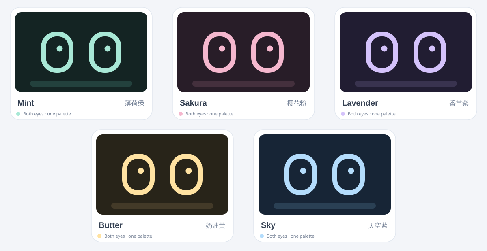

# esp-bot

**小呆 (Xiao Dai)** — a quiet, passive desktop companion built around ESP32-S31-Korvo-1. Local gaze, wake and behavior should not depend on Mac/Linux; the future Rust/Tauri Brain provides language reasoning, speech and tools. The only production voice wake phrase is **小呆小呆**, a single continuous four-syllable keyword. A standalone **小呆** must never wake the device.

> Hardware target is **ESP32-S31-Korvo-1 V1.1** (ESP32-S31), **not** ESP32-S3-Korvo-1. The S31 board has an 800×480 RGB display and GT1151 touch panel. Use ESP-IDF 6.1 / `esp32s31`, not `esp32s3`.

## New project direction: reuse-first + Mac-first (2026-10-30)

**小呆 now prioritizes mature open-source modules rather than recreating audio, media, hardware or inference stacks.** Our **M4 Pro / 48 GB Mac with Rust/Tauri `server/bot-server`** is the primary local AI Brain. The device favors secure Wi-Fi mDNS, with **Bluetooth (BLE) Mac provisioning and control fallback** when Wi-Fi is unconfigured or offline. Mac-local STT/LLM/TTS is the default; cloud models/search are optional and permission-controlled. **All device-local wake/behavior stays independent of Mac availability.**

The **new physical target** is a good-looking enclosed **pan/tilt** head with integrated external loudspeakers using off-the-shelf mechanical parts. The *current* physical prototype remains unactuated until hardware has been chosen/installed. Korvo-1 already has **two integrated 3 W speaker amplifiers**; select compatible speakers and wiring rather than another audio amplifier.

- **[Local-First Hybrid Brain: canonical new deployment + BLE fallback](docs/local-first-hybrid-brain.md)**
- **[Upstream reuse catalog: verified project links, ports, licenses, adoption priorities](docs/upstream-reuse-catalog.md)**
- **[Off-the-shelf hardware shortlist: official Korvo shell STL/STEP, pan/tilt kits and speakers](docs/off-the-shelf-hardware.md)**
**精确型号/打印文件与采购顺序：** [3D 打印 + 扬声器 + 云台 + 电源 BOM V2](docs/print-files-and-bom-v2.md)（含制造商、型号、数量、渠道、STL/STEP、兼容风险与装配示意要求）。

- **[Current system authority / behavior architecture](docs/architecture.md)**

**Status:** These are updated decisions and research. No claims of compiled BLE, working local Mac speech engine, motor assembly or production secure pairing.

## Identity and wake-word policy

The robot is named **小呆** (Xiao Dai). Its **only production wake phrase is 小呆小呆**, recognized as one complete four-syllable on-device keyword. A single 小呆 must not wake it. A screen-off night state still keeps the local wake listener active. See [wake-word specification](docs/wake-word.md) and [shared identity manifest](shared/bot-identity.json). **The dedicated keyword model and wake integration are not yet provisioned or hardware-validated**; merely setting the display name does not enable custom wake recognition.

## System decisions and authoritative documents

**Hardware currently installed:** fixed, non-actuated head/camera (the whole device can be moved by hand); **no IMU and no physical pan/tilt yet**. A new off-the-shelf enclosed pan/tilt build is now the physical target. When a target stays inside camera FOV, the screen eyes can follow its eye midpoint; software cannot mechanically turn the camera back after the person leaves the image. Future pan/tilt and optional IMU use the same target/gaze controller via replaceable adapters.

**Behavior V1:** idle → bored → drowsy → asleep, optional night LCD sleep; no spontaneous greetings and no waking merely because a face appears or someone looks at Bot. Wake is always local by **小呆小呆** (or deliberate touch/manual action). Camera may sleep at night; on-device keyword listening remains active. A dedicated four-syllable wake model has **not** yet been provisioned, and end-to-end hardware wake is NOT implemented.

The canonical system ownership specification is **[docs/architecture.md](docs/architecture.md)**, with deployment/provider/Bluetooth policy in **[docs/local-first-hybrid-brain.md](docs/local-first-hybrid-brain.md)**. Related ownership-specific sources:

| Document | Owns |
| --- | --- |
| [Module contracts and bot_bus](docs/module-contracts.md) | bot_runtime/bot_bus, events, latest snapshots, permissions, freshness |
| [Passive behavior and night lifecycle](docs/behavior-lifecycle.md) | Idle, bored, drowsy, sleeping, night dark, waking, conversation |
| [Wake phrase 小呆小呆](docs/wake-word.md) · [identity manifest](shared/bot-identity.json) | Only wake phrase, offline audio, model resource and negative cases |
| [Eye–head coordination / visual follow](docs/eye-contact.md) | V1 fixed-camera visual correction, future motors and IMU |
| [Multi-face visual perception](docs/visual-attention.md) | Eye landmarks, pupils, uncertainty, per-person gaze/track time |
| [Two-mic acoustic DOA](docs/audio-direction.md) | Sound bearing hints and front/back ambiguity; not a wake engine |
| [Hardware / sensor / power](docs/hardware-power.md) | Real S31 capability, camera exposure, display sleep limits |
| [Implementation roadmap](docs/implementation-roadmap.md) | Existing versus planned code, integration order and disclosure |
| [Appearance design](docs/face-design.md) · [LAN discovery](docs/lan-discovery.md) | UI/Face and existing isolated link architecture |

**No CI:** this project is code-first; do not create CI workflows or block implementation on unavailable test hardware. Report build/device verification honestly (see [AGENTS.md](AGENTS.md)).

## Repository layout

| Path | Responsibility |
| --- | --- |
| `firmware/` | ESP-IDF device program; official S31 Korvo-1 BSP, reusable LVGL face component, Wi-Fi Brain client |
| `firmware/components/face/` | Reusable expression controller, pluggable eye renderers, subtitles and Settings -> Appearance UI |
| `firmware/components/attention/` | Independent eye-contact geometry: shared gaze direction, head setpoints and confidence gating |
| `firmware/components/vision_attention/` | On-board-ready multi-face tracking core with separate per-person eye positions, gaze events, fixation times and provisional pupil localization; not camera-integrated yet |
| `server/` | Older Python Brain prototype and new Rust/Tauri `server/bot-server/` discovery console; not yet combined into final speech/LLM service |
| `shared/` | Canonical theme tokens and documented JSON/HTTP contract |
| `preview/` | Browser-based interactive face preview; no board required |
| `tools/` | Generate firmware color header from the shared theme JSON |
| `docs/` | Design rules, integration and staged roadmap |

## Theme gallery



## Quick start

### Face preview (first)

From the repository root:

```sh
python3 -m http.server 8765 --bind 127.0.0.1
# open http://127.0.0.1:8765/preview/
```

Touch the simulated screen to show the corner gear (auto-hides after five seconds). Open **Settings → Appearance**, select one of the five installed pastel appearances (mint/sakura/lavender/butter/sky), then press **Apply** to return to the face. Selection does nothing until Apply, and the preview persists the choice in localStorage. All five shipped styles share an outline renderer; future appearance packs can choose entirely different eye geometries, assets and motion profiles. Use the debug panels below the screen to test expressions, gaze direction and subtitles.

### Brain server (Python 3.10+)

```sh
cd server
python3 -m espbot
# http://127.0.0.1:8766/health
```

No third-party Python dependencies. Local-only by default. For ESP32 Wi-Fi access, set `ESPBOT_BIND=0.0.0.0` **and** `ESPBOT_TOKEN` to a random secret; see [server/README.md](server/README.md). Do not expose this plain HTTP prototype directly to the internet.

### Firmware (S31 board)

Use Espressif **ESP-IDF 6.1+ with ESP32-S31 support**, then:

```sh
cd firmware
idf.py set-target esp32s31
idf.py menuconfig  # ESP Bot: optional Wi-Fi, Brain URL and shared token
idf.py build
idf.py -p /dev/ttyACM0 flash monitor
```

The face can run without a Brain connection. The ESP-IDF build and real-device testing still need to be performed on the actual board; these steps are **not** claimed as hardware-validated.

## Face module API

```c
face_view_t *face = face_create(lv_screen_active());
face_set_theme(face, "lavender");
face_set_expression(face, "curious");
face_set_gaze(face, 35, -20);        // normalized -100..100
face_set_subtitle(face, "Hello!");
```

One face API, multiple appearance packs. A pack selects a renderer, colors and motion timings (not just different colors in each eye). The installed macaron packs use matching colors for both eyes; the future alternative pill renderer is already implemented. The only optional mouth marks are a surprise dot and a tiny shy curve. The gear is touch-revealed for five seconds, then opens **Settings → Appearance → Apply**. Applied choices are persisted to ESP32 NVS by the application, not by the face component.

## Roadmap and boundaries

**In this baseline:** LVGL Face component with independent renderers and five installed macaron appearances; two-level Settings → Appearance → Apply navigation with NVS persistence; touch-revealed gear; blinking, shared pupil gaze and subtitle area; a host-testable Attention coordinator that calculates coupled head/gaze targets and refuses false mutual-eye-contact claims; Python Brain HTTP command queues, optional text-model adapter and allowlisted tool registry; optional ESP32 Wi-Fi polling.

**Architecture update:** bot_runtime, bot_bus, attention_manager, head_motion stationary adapter and unified audio/wake modules are documented **but not implemented**. Rust/Tauri LAN server and lan_link are standalone modules not yet app-integrated. The current shipped app still starts LVGL Face plus optional legacy Python Brain polling.

**Vision core now available separately:** [multi-person visual attention specification](docs/visual-attention.md), [vision_attention C component](firmware/components/vision_attention/README.md). Multi-face tracking and candidate iris localization are implemented as independent cores; ESP-DL camera capture and genuine calibrated gaze recognition are still pending.

**Later:** full ESP-IDF and real-board build/flash verification; camera face detection and a *separate* classifier for whether the person looks at the robot; 3D camera-to-display/head calibration; servo feedback and pan/tilt actuation; speech streaming, TTS, Wi-Fi discovery, pairing and encryption. The current Attention module is a geometric **planner**, not a working camera or motor driver.

Read [face design](docs/face-design.md), [appearance pack contract](shared/appearance-packs.md), [human eye-contact architecture](docs/eye-contact.md), and [device/Brain protocol](shared/protocol.md) before integrating new components.

## Delivery and validation policy

This project intentionally has **no CI workflows**. See [AGENTS.md](AGENTS.md). If suitable equipment or a practical runtime is unavailable, development proceeds by delivering modular source code and documenting what has **not** been built, run or validated on real hardware. Existing optional local test code does not constitute device verification.

## References

- [Espressif ESP32-S31-Korvo-1 BSP](https://github.com/espressif/esp-bsp/tree/master/bsp/esp32_s31_korvo_1)
- [ESP32-S31 Korvo-1 board reference](https://docs.espressif.com/projects/esp-board-manager/en/latest/references/boards/esp32_s31_korvo_1.html)
- [ESP-IDF ESP32-S31 getting started](https://docs.espressif.com/projects/esp-idf/en/v6.1/esp32s31/get-started/index.html)
- [Albert.io mascot reference](https://dribbble.com/shots/26730038-Brand-Mascot-Design-for-Albert-io) — used solely as a high-level *simplicity* reference, not copied assets.
