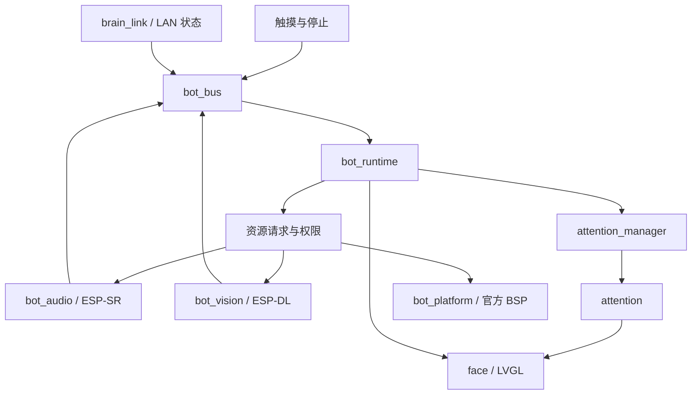

# 小呆设备本地 Runtime — 实现与接入指南

更新：2026-11-06。目标：**ESP32-S31-Korvo-1 V1.1 / ESP32-S31 / ESP-IDF 6.1+**。

本次交付把本地运行时、官方语音/摄像头适配器和现有表情/注视模块写入同一个固件入口。**硬件尚未到货；按用户要求，没有编译、没有运行测试、没有刷机、没有新增 CI。** 下文的“已实现”指源代码与调用链已写入，不代表已在设备上验证。

## 1. 这一版交付什么

| 能力 | 本次源代码 | 仍需要的资源或后续工作 |
|---|---|---|
| 本地生命周期 | `bot_runtime`：被动状态、唤醒、会话子状态、停止、超时、设置优先、故障降级 | 实机调整交互时间与资源占用 |
| 消息和状态 | `bot_bus`：有界队列、独立停止锁存、关键事件溢出故障、最新视觉快照 | 后续增加媒体通道时保持所有权边界 |
| 显示与触摸 | `bot_platform` 封装官方 BSP；`face` 输出触摸/停止/设置事件 | 真正的背光熄灭未实现；当前 BSP 明确不支持亮度控制 |
| 本地语音 | 单个 ES8389 codec 所有者；官方 ESP-SR AFE、WakeNet、VAD；有界 PCM 播放和取消 | **完整“小呆小呆”专用声学模型尚未提供**；声道/声学效果待硬件验证 |
| 摄像头和人脸 | 官方 BSP + esp_video V4L2 + ESP-DL `HumanFaceDetect`；多脸框、五点关键点、临时跟踪 | 摄像头方向、曝光、内存/性能和注视几何待实机确认 |
| 选人和眼睛跟随 | `attention_manager` 选唯一目标；`attention` 固定相机坐标模式；LVGL 双眼一致移动 | 不是家庭成员身份识别，也不是真正的人眼视线估计 |
| 头部能力 | `head_motion` 固定头部适配器；无电机、无 IMU、无有效测量姿态 | 真实云台、限位、反馈和运动安全以后接入 |
| Mac 连接边界 | `brain_link` 接已有 Wi-Fi/mDNS/WS；上报本地连接状态；拒绝未认证控制 | 固件 WSS v3 客户端、证书/凭据接入、BLE 配网和设备媒体接线；Mac ASR/LLM/TTS/harness 已另行写入源码 |

Mac 端后续交付见 [mac-bot-server.md](mac-bot-server.md)。该服务端与
[WSS v3 契约](../shared/mac-brain-v3.md) 已有源码，但本设备入口尚未连接它，
不能把服务端完成理解为固件已经上传录音或播放模型回复。

旧 `main/brain_client.c` 保留为历史代码，但从 `main/CMakeLists.txt` 和启动链路移除。它不会与 runtime 同时争夺 Face，也不会继续轮询 Python HTTP Brain。

## 2. 模块与实际调用链

入口在 [`firmware/main/app_main.c`](../firmware/main/app_main.c)。它装配回调和资源，不另建一套决策状态机：

1. 创建 bus 和 platform，初始化共享 I2C、NVS、官方 LCD/触摸与 Face。NVS 初始化失败时关闭偏好存储，不自动擦除潜在配对数据。
2. 创建本地 runtime 和固定相机 attention 控制器。UI 回调只排队；主题偏好由运行时任务离开 LVGL 锁后写 NVS。
3. 启动唯一 audio owner。麦克风采集与本地 AFE 持续运行，缺少 WakeNet 模型时显式降级；它不自动打开会话或网络 PCM 权限。
4. 创建视觉 worker，**初始暂停**；显式唤醒后由 runtime 请求启用摄像头。视觉模型不在主控制任务或 LVGL 回调中执行。
5. 可选启动 Wi-Fi 与 LAN 发现。SSID 留空就是离线本地运行，不影响本地控制。
6. 单个 `bot_runtime` 任务以约 20 ms 调度周期处理事件、仲裁权限、调用 attention，再在 BSP 显示锁内更新 Face。这个周期是调度配置，不是测得的实时响应保证。

主要公共接口：

| 模块 | 接口和责任 |
|---|---|
| [`bot_runtime`](../firmware/components/bot_runtime/README.md) | `create/step/get_snapshot`，单 owner；`apply_state/stop_output/cancel_remote/command_result` 注入副作用 |
| [`bot_bus`](../firmware/components/bot_bus/include/bot_bus.h) | `post/receive`、`submit_command`、`publish_vision`、独立 `request_stop`；不包含音视频指针 |
| [`bot_audio`](../firmware/components/bot_audio/README.md) | `create/start/set_session`；`playback_begin/write/end/cancel`；事件和借用 PCM 回调 |
| [`bot_vision`](../firmware/components/bot_vision/README.md) | `start/set_enabled/get_status/stop`；一个 worker 负责驱动、推理和快照 |
| [`attention_manager`](../firmware/components/attention_manager/include/attention_manager.h) | 所有可见脸 → 唯一 focus，带获取/切换迟滞和短时丢失 |
| [`attention`](../firmware/components/attention/include/attention.h) | `observe_stationary` 不要求伪造头部姿态；输出统一的左右眼偏移 |
| [`face`](../firmware/components/face/include/face.h) | 表情/字幕/主题渲染、触摸意图、停止按钮；不选择人或决定唤醒 |

`bot_platform` 负责共享板级初始化；音频设备只由 `bot_audio` 打开一次，V4L2 流只由 `bot_vision` 持有。不能为了播放、唤醒或 DOA 再开第二条麦克风采集。

## 3. 行为、会话和取消

### 被动状态

默认时间为最后一次有效交互后：60 秒进入 `BORED`，180 秒进入 `DROWSY`，300 秒进入 `SLEEPING`。状态分别映射到 idle、bored、drowsy、sleeping 表情。它们不讲话、不主动问候，也不因为路过的人脸重置空闲时间。

只有经过本地识别的**一个完整“小呆小呆”关键词**，或者有意触摸，能进入 `WAKING → ENGAGED`。普通语音能量、VAD、看向机器人、人脸出现均不构成唤醒。专用模型缺失时，屏幕保留“点一下，叫醒小呆”。

活动会话有 listening / thinking / speaking / waiting 子状态。speaking 的会话状态来自本地实际播放开始事件，完成来自本地播放结束事件，远端不能把“文本生成完了”冒充“扬声器播完了”。当前没有接入 Mac 对话服务，屏幕会明确显示语音对话尚未接通；不会生成假回答。

`BOT_RUNTIME_PROGRESS_TIMEOUT_MS` 默认 60 秒，是**会话没有状态进展的硬时限**，包括一直说话或播放的情况，并非只在安静时计时。连续 PCM、重复字幕和重复完成通知不会无限续期。以后接入长故事时应明确调大此配置，或者增加经审核的播放进展机制；本次没有声称支持无限长度会话。

触摸停止按钮使用 bus 的独立锁存，**不会排在普通命令队列后面**。设置界面打开也会终止活动会话并关闭会话音频权限；关闭设置不会自动重新开始对话。Face 的事件回调不进行网络请求、推理或阻塞驱动操作。

### 会话令牌

`epoch / session_id / turn_id / focus_generation` 与每次操作一起复制。取消、新会话或新轮次使旧令牌失效。声音结束事件必须携带**开始播放时的原令牌**，不能为了让旧事件通过而改成当前令牌。

本地停止先撤销输出权限，再请求本地播放器停止，最后留出远端取消钩子。`app_main` 的 `apply_state` 在撤销中间态立即调用 `bot_audio_set_session`，避免等下一个渲染周期才关门。当前远端取消钩子不发送消息，因为还没有安装经过认证的会话传输层。

播放事件还必须携带本地真实 `playback_id`，防止同一轮中较早音频的结束通知结束较新的播放。WAITING 收到下一次 VAD START 时先更换 turn，音频适配器重置 AFE/VAD 后以新 token 重新报告持续语音；不把旧 token 的 END 挪到新轮次。完全落在切换窗口中的极短语音可能丢失，后续安全音频会话接入时需考虑这个已知边界。

远端语义命令在 runtime 中仍需同时满足：活动会话、正确令牌、接收时间未过期、已认证且加密的连接、没有设置/故障覆盖。协议里没有直接操作瞳孔或舵机的命令。

### 有界缓冲与故障

事件、命令、播放 PCM 都有固定上限，队列满返回明确错误。普通事件损失有计数；关键事件队列溢出会使 runtime 关闭会话权限、取消输出并锁住故障。停止信号不依赖队列剩余空间。当前 UI 遇到这种故障提示重新启动；内部 `clear_fault` 供未来本地恢复流程使用，不能让网络命令自行清除故障并恢复旧会话。

本地时间使用 `esp_timer` 单调时钟；bus 使用低 32 位毫秒和短时有效期，音频内部保留微秒。远端 `sent_at`、墙上时钟和网络时延不参与逐帧控制。具体默认上限和令牌规则以组件头文件/README 为准。

## 4. 官方语音复用和专用唤醒模型

依赖关系：官方 **BSP 1.1.0 → esp_codec_dev 1.5.11**，`bot_audio` 使用 **ESP-SR 2.6.1**。采用官方 codec、AFE feed/fetch、WakeNet 结果和 WebRTC VAD 接口；没有重写 I2S 驱动、语音识别器或音频编解码器。

实现包含：单次板级音频初始化、唯一 codec 输入输出所有者、16 kHz PCM 管线、AFE 工作任务、WakeNet/VAD 事件、缺失模型报告，以及独立播放器。播放器使用有界的 20 ms PCM 块，提供取消锁存和旧流令牌检查。播放 API 接收 **16 kHz、单声道、PCM16**，不是 MP3/Opus/TTS 引擎；以后由 Mac 或独立解码适配器提供数据。

模型准备要同时满足：

- 模型适用于 ESP32-S31 和所选 ESP-SR/WakeNet 版本。
- `BOT_AUDIO_WAKE_MODEL_NAME` 与模型包内 entry name 精确一致。
- 模型关键词元数据为完整 `小呆小呆`，不是两次独立的 `小呆` 命中，也不是 stock 唤醒词改了显示名。
- 使用官方模型打包方式装入名为 `model` 的数据分区。具体资源与配置见 [`bot_audio/README.md`](../firmware/components/bot_audio/README.md)。

本仓库**没有附带该定制模型**，`shared/bot-identity.json` 继续保持 `recognition_model: unprovisioned`。空名称、无分区资源或关键词不匹配都不能报告 Wake Ready。AFE 返回的关键词命中没有校准概率时，事件标为 `confidence_available=false`，不会编造 0.99 置信度。

官方 ESP-SR 会把生成的 `srmodels.bin` 加到完整 flash 流程；以后完整刷机时必须保留正确的外部模型配置，否则可能覆盖手工写入的定制模型。`model` 分区虽然使用 spiffs subtype，这里装的是官方原始模型容器，不要当作文件系统挂载/格式化。可复现的外部模型配置与官方打包命令已写在 audio README，均为以后使用的说明，本次没有执行。

### 回声和隐私的当前实现

本次没有经硬件确认的扬声器回采参考，因此 **AEC 能力和自动 VAD 插话均为 false**。机器人播放期间及播放尾音窗口抑制自身唤醒/VAD；触摸停止仍可用。这是明确的当前工作模式，不能描述成已完成全双工回声消除。

原始麦克风 PCM 的释放有两道门：已授权本地会话 + 被允许的安全传输。新开门前丢弃可能残留的 RX DMA 缓冲，不把唤醒前录到的房间声音当作会话内容上传。当前 `app_main` 不注册 PCM 消费者，上传权限保持关闭。没有环境录音、音频文件保存、声纹注册或云端上传。

## 5. 官方视觉复用和人脸含义

[`bot_vision`](../firmware/components/bot_vision/README.md) 使用官方 `bsp_camera_start(NULL)` 配置共享 I2C、相机时钟和引脚，再通过 **esp_video 2.4.1** 的 V4L2 接口获取 OV3660 图像。官方 **human_face_detect 0.5.2 / ESP-DL 3.3 系列** 的 `MSRMNP_S8_V1` 提供人脸框和五点关键点。

代码负责 V4L2 队列、图像格式转换、方向处理、暗帧/无效帧过滤、模型结果转为 `vatt_observation_t`，然后复用既有 `vision_attention` 跟踪器。图像内存不进入 bus、不进入日志、不上传网络；bus 只复制几何/质量快照。

这里的能力是**人脸检测、眼部关键点和临时多目标跟踪**。它不能回答“这是妈妈还是孩子”，也不会把临时 track ID 存成家庭成员身份。五点关键点表示眼睛在哪里，不能证明眼睛正在看机器人；当前适配器不伪造 gaze、虹膜、头部朝向或 mutual-eye-contact。

选人只由 `attention_manager` 完成，不采用旧快照的 `primary_track_id` 作为权威。attention 使用选定目标的眼睛中点生成共同眼睛偏移；人仍在画面侧边时，眼睛不会因为假设头部已经转过去而自动回中。目标失踪时使定位失效，不假装固定相机能转头重找。

### 时间戳、方向和暂停的真实边界

- 此版 esp_video DVP 的 `VIDIOC_DQBUF` 不填写有效的 sensor exposure timestamp。适配器清理积压帧后，用**推理前出队单调时间估计**并公开 `DEQUEUE_ESTIMATE / capture_timestamp_exact=false / capture_uncertainty_ms`。不能把推理结束时间改写成“新鲜采集”。
- 默认按官方 OV3660 安装方向做 180° 旋转，但 `calibration_valid` 默认 false。镜像、有效视场角和相机到屏幕的关系要等实物确认。当前 60°/45° FOV 是初始映射参数，不是测得的镜头规格。
- 夜间/被动状态执行 `STREAMOFF` 并停止推理；正在执行的同步推理完成后才响应暂停。它不等价于切断传感器电源。
- 当前官方 BSP 的相机启动函数持有不可外部释放的 XCLK 资源。为了避免失败重试时反复分配，platform 每次开机只尝试一次 BSP bootstrap，并缓存结果；V4L2 打开/流控制可由 worker 重试。bootstrap 失败后需要重新启动，不能宣称完整热恢复。

## 6. 夜间、固定头部和板级限制

显示使用一个顶层黑色覆盖层，覆盖 Face 和设置但保留触摸回调。当前官方 BSP `bsp_display_backlight_on/off` 经 `bsp_display_brightness_set` 明确返回 `ESP_ERR_NOT_SUPPORTED`；`bsp_display_enter_sleep` 又会休眠触摸。所以当前实现**不调用后者**，保留黑屏触摸唤醒，并公开 `full_blackout_verified=false`。

本地音频 owner 不随 display/camera 暂停而关闭；这是应用层休眠，不是 ESP deep sleep。专用模型缺失时，夜间同样不能通过语音唤醒，触摸是可用入口。

可选夜间时段在 `ESP Bot` 配置中，默认关闭。开启后采用 POSIX 时区和本地时段，默认例值 22:30–07:00。只有系统墙上时钟已初始化为合理日期才启用；此固件没有偷偷启用 SNTP，也没有完成可信授时/家长配置 UI。无有效时钟时按普通空闲计时休眠。

`head_motion_get_status` 明确报告 `stationary=true, motors_installed=false, imu_installed=false, measured_pose_valid=false`；不可用的测量角度用 NAN 表示。运动请求返回 `ESP_ERR_NOT_SUPPORTED`。以后装电机时替换适配器并加入真实限位/反馈，不要修改表情代码模拟硬件已安装。

## 7. 配置、分区和升级边界

依赖声明分别在 `main/idf_component.yml`、`bot_audio/idf_component.yml`、`bot_vision/idf_component.yml`。本次不运行依赖解析，所以没有伪造 `dependencies.lock`；后续首次真实构建解析出的依赖锁需由实际工具链生成。

`sdkconfig.defaults` 复用了官方 S31 摄像头/LVGL 示例中的 PSRAM、RGB 缓冲和 OV3660 设置，省略 S3 专用或其他板子的配置。`BSP_ERROR_CHECK=n` 让已知外设错误返回上层降级处理，而不是一出错就终止整个应用。

16 MB flash 的 [`partitions.csv`](../firmware/partitions.csv)：

| 分区 | Offset | Size | 用途 |
|---|---|---|---|
| nvs | `0x9000` | `0x6000` | 外观等本地偏好 |
| phy_init | `0xf000` | `0x1000` | PHY 数据 |
| factory | `0x10000` | `0x800000` | 8 MB 应用；人脸模型使用组件的 rodata 模式 |
| model | `0x810000` | `0x600000` | 6 MB 官方语音模型容器；不是预置小呆模型 |
| storage | `0xe10000` | `0x1f0000` | 预留，当前不挂载、不记录音视频 |

这是一张新的开发分区表，**没有 OTA 双槽**。后续烧录时应先确认真实模组 flash 容量和已有数据布局；不要把这里的偏移套到其他板型。无需现在执行构建或刷机。

主要配置：专用唤醒模型名、音量/麦克风增益、播放尾音窗口、被动时间策略、Wi-Fi/设备 ID、可选夜间时段、视觉方向/视场角。音量百分比只是 codec 电气增益，不是测过的声压值。

## 8. 后续 Mac / harness 的接点

此版 local runtime 不依赖某个 LLM provider。未来 Mac 无论采用 ChatGPT/Codex app-server、其他 harness 或自建服务，都应通过同一套**语义命令 + 会话令牌 + 媒体通道**接入：

1. 先完成配对、认证与加密。当前 Rust LAN hello/welcome、设备列表批准和 mDNS 均不能代替密码学认证。
2. 安全连接成功后，向 runtime 发真实的连接能力事件，协商 boot/session/turn/epoch。不要直接用 JSON 填 `face_set_gaze` 或触碰硬件。
3. 在授权的活动会话内，从 audio PCM 回调复制到独立、有界媒体队列；网络任务自己检查令牌有效性并发送，不在采集回调里等待网络。
4. Mac 回传语义表情/字幕和带原令牌的 PCM。播放器开始/结束由本地硬件 owner 确认；停止先在本地生效，再取消远端生成。
5. 图片、动画和网页 scene player 可在未来独立增加，沿用同一套取消/时效/资源优先级；本次未实现 HTML/WebView、GIF 下载、工具执行、持久人物记忆。

当前 `brain_link` 只把旧 LAN 变成诊断入口。收到服务器 `face.set` 等 request，会返回 `AUTH_REQUIRED`，不会绕过 runtime。`lan_link` 新增 response 发送和连接代际约束，旧连接排队的输出不会在新连接重放。服务器的现有开发命令面板因此会看到明确拒绝；这是统一控制权的实际切换点，不是端到端 Mac 语音已经完成。

## 9. 上游来源与复用方式

优先采用依赖/适配器，没有复制一套驱动、神经网络或整个机器人项目。上游代码和权重的许可分别遵守其原仓库规定；本次未附带自定义唤醒权重、声纹库、人物图片或第三方语音素材。

| 上游 | 本次采用方式 |
|---|---|
| [Espressif S31 BSP](https://github.com/espressif/esp-bsp/tree/67f41a169401d1f23e827188dd08fb351cb0febe/bsp/esp32_s31_korvo_1) | 管脚、共享 I2C、RGB LCD、GT1151、音频、相机 bootstrap；组件固定 1.1.0 |
| [官方 display_camera_video 的 S31 配置](https://github.com/espressif/esp-bsp/blob/67f41a169401d1f23e827188dd08fb351cb0febe/examples/display_camera_video/sdkconfig.bsp.esp32_s31_korvo_1) | PSRAM、LVGL/RGB、OV3660 模式和 XCLK 设置 |
| [官方 BSP display 实现](https://github.com/espressif/esp-bsp/blob/67f41a169401d1f23e827188dd08fb351cb0febe/bsp/esp32_s31_korvo_1/src/bsp_display.c) | 背光不可控和 touch sleep 的实际边界；没有编造熄屏能力 |
| [ESP-SR](https://github.com/espressif/esp-sr) / [esp-skainet](https://github.com/espressif/esp-skainet) | AFE/WakeNet/VAD 官方接口和使用方式；详见 audio README 的固定版本/文件来源 |
| [esp_codec_dev](https://github.com/espressif/esp-adf/tree/master/components/esp_codec_dev) | ES8389 设备与音量/读写；不是另写 codec 驱动 |
| [esp-video-components](https://github.com/espressif/esp-video-components) | V4L2、OV3660 传感器与缓冲区接口 |
| [ESP-DL HumanFaceDetect](https://github.com/espressif/esp-dl/tree/master/models/human_face_detect) | MSR/MNP 和五点关键点；模型随官方组件，细节见 vision README |
| [ESP-IDF station example](https://github.com/espressif/esp-idf/tree/v6.1/examples/wifi/getting_started/station) | Wi-Fi STA 初始化/事件方式；现有 lan_link 继续复用 |

后续工作优先是准备完整唤醒模型、真实硬件到货后的配置确认，以及安全 Mac 音频链路。此文是源码交付记录与接线说明，不包含本次未执行的测试结果。
