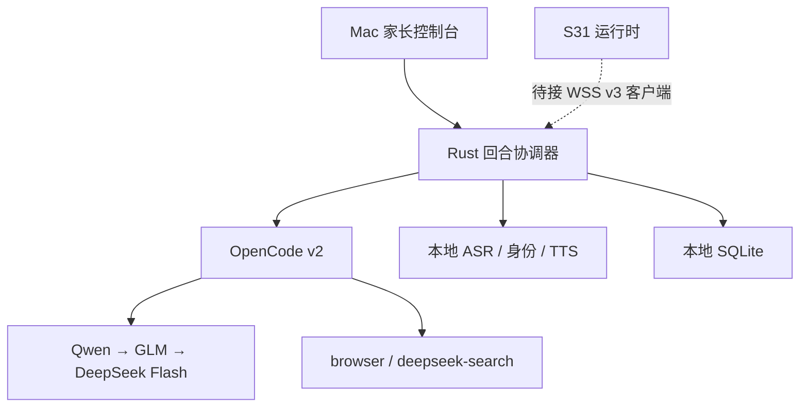

# 小呆 Mac bot-server：OpenCode、多模型、本地声音与记忆

**2026-11-06 源码交付。** 本轮直接在现有 Rust/Tauri `server/bot-server`
上增加 Mac 大脑、家长控制台、本地模型服务和安全设备网关。没有运行测试、构建、
CI、模型、付费接口或真实设备；硬件尚未到货。这里的“已实现”指源码和调用链已经写入，
不代表完成了 Mac 安装或 S31 联调。

## 1. 现在的组成

| 模块 | 实际职责 |
| --- | --- |
| `src-tauri/src/brain` | 主动回合、输入限制、ASR→harness→场景→TTS、取消、配置、Tauri API、WSS 网关 |
| `src-tauri/src/harness` | 官方 OpenCode v2 常驻进程、native HTTP/SSE、会话、权限、模型路由、额度退避和删除 |
| `local-models` | Apple MLX Whisper、SpeechBrain ECAPA、OpenCV YuNet/SFace、macOS 系统 TTS |
| `src-tauri/src/memory` | SQLite 档案、确认后的记忆、声纹/人脸模板、匹配和遗忘 |
| `src/companion.ts` / `capture.ts` | 无设备也可使用的中文控制台、明确点击的录音/拍照、家长管理、回复卡片 |
| `tools/deepseek_search.py` | 可选 DeepSeek 官方 Search / Fetch MCP 适配器；有现有配置时直接继承 |
| 原有 `lan` / `provider` | 原 LAN 诊断、软配对、OpenAI-compatible / S2S 文字适配保留，独立于新链路 |



设备仍独占唤醒、注意力、眼睛跟随和物理执行。Mac 返回表达意图、文字、音频和卡片，
不会发每帧瞳孔坐标或舵机角度。仅完整 **小呆小呆** 或明确触摸开启设备交互；
声音能量、脸出现和识别候选不会自动开启对话。

## 2. OpenCode 与模型顺序

查阅并固定适配的官方稳定 v2 为 **2.2.5**。使用 v2 的 `/api/info`、
`/api/session`、`/api/event`、`/api/session/{id}/prompt` 与 `interrupt` 等实际接口，
不会把旧版 `/session/{id}/message` 示例混进来。启动时检查版本，接受兼容的
`2.2.5 <= version < 3`；未来升级仍需要按实际 API 变化维护。

默认顺序写在 `harness/config.rs`：

| 顺序 | 配置路由 | 默认模型 | 凭据环境变量 |
| --- | --- | --- | --- |
| 1 | `qwen-coding-plan` | `qwen3.7-plus` | `QWEN_CODING_PLAN_API_KEY` |
| 2 | `glm-coding-plan` | `glm-5.3` | `GLM_CODING_PLAN_API_KEY` |
| 3 | `deepseek-flash` | `deepseek-flash` | `DEEPSEEK_API_KEY` |

模型名、地区端点、provider ID、enabled 和顺序都可以配置；`base_url: null` 可使用
已经在 OpenCode 中配置的 provider。Qwen Code 的 OAuth 登录不被冒充为百炼 Coding Plan
API key；GLM 国内与国际账户也不混用端点。完整说明见 [mac-opencode.md](mac-opencode.md)。

明确的额度/余额耗尽会触发下一条可用路由；普通 `429` 默认作为限流处理，
不假装知道月度额度已经耗尽。鉴权、模型配置、网络失败分别返回错误。额度状态是
本地退避时间和 provider 提示，**不是剩余额度仪表**。如果工具已经开始执行、产生输出，
或上游是否执行不能确定，不会自动换模型重跑同一回合。

阿里云当前 Coding Plan 文档对自定义应用后端等用途有明确限制。这里保留用户指定的
接法与顺序，但 OpenCode 并不会改变套餐适用范围。账户不适用时，应将对应 route
改成该账户允许的普通 API / provider；不要通过改客户端标识绕过限制。
[官方套餐说明](https://help.aliyun.com/zh/model-studio/coding-plan-faq)。
DeepSeek 当前正式 Flash 名称以 [官方 API 文档](https://api-docs.deepseek.com/quick_start/agent_integrations/)
为依据。

## 3. 第一次在 Mac 上准备

以下是给之后的 Mac 环境执行的安装步骤，本轮没有执行。文本对话不需要 ESP 板；
本地语音和身份功能需要准备模型环境。Mac 目标是原生 Apple Silicon / M4 Pro 48 GB。

### 3.1 OpenCode 与依赖

按 [OpenCode 接入文档](mac-opencode.md) 安装 **v2.2.5 或兼容的后续 v2**，
不要仅凭旧安装器的 `latest` 名字认定主版本。准备 Node.js、Rust/Tauri 所需的 Mac
开发依赖。原有前端仍使用 `npm ci`，没有增加前端依赖。

本轮新增 `rusqlite` 等 Rust 直接依赖，并启用已有 Tokio/Reqwest 功能。
仓库保留原有 `Cargo.lock`，**这次没有重解 Rust 依赖图**；第一次在 Mac 进行 Cargo
构建时需正常解析并更新锁文件，不要把现有锁文件当成本次已解析环境或用 `--locked`
强行启动。Python requirements 同样注明了直接版本与未解析的兼容范围。

### 3.2 本地模型

在 `server/bot-server` 目录中：

```bash
python3.11 -m venv local-models/.venv
local-models/.venv/bin/python -m pip install -r local-models/requirements.txt

XIAODAI_MODEL_DIR="$HOME/Library/Application Support/ai.reasonia.espbot.server/models"
local-models/.venv/bin/python local-models/provision_models.py \
  --model-dir "$XIAODAI_MODEL_DIR" --only asr speaker face

python3 scripts/configure_mac.py
```

`configure_mac.py` 只写应用配置中的绝对路径、已安装的 OpenCode 可执行文件和系统声音，
保留其他字段并备份已有配置；不会启动模型、录音、摄像头或测试。需要继承指定配置时：

```bash
python3 scripts/configure_mac.py --inherit-config /absolute/path/opencode.jsonc
```

模型下载固定 revision，并校验安装收据。之后的 worker 启动/推理不下载模型。
模型目录与个人数据库分开。系统声音默认 `Tingting`，缺失时如实返回错误，
可换为本机已经安装的普通话声音。详见 [本地模型文档](mac-local-models.md)。

### 3.3 凭据与工具

将 `server/bot-server/.env.example` 复制为本地 `.env`，填写账户自己的 key，
从加载这些环境变量的终端启动 Tauri。该文件已经被 git 忽略。Finder 启动的 App
不会自动获得另一个终端里的 export；需要使用配置过环境的启动方式。
控制台只显示环境变量名和是否存在，不回显实际 key。

`browser` 和 `deepseek-search` 由 OpenCode 的配置加载器继承。缺少时界面显示缺少，
不会虚构可用工具。可选安装方法与 v2 配置示例在
[`tools/README.md`](../server/bot-server/tools/README.md)。DeepSeek Search / Fetch
使用自己的服务计费，与 Coding Plan 模型额度分开。

启动入口仍是：

```bash
npm ci
npm run tauri dev
```

App 默认不会自动启动 harness；进入“小呆”页后点启动。
`brain.json.auto_start` 可以在配置后开启。原有 `config.json` 只控制历史文字 provider，
新主链路读取独立 `brain.json`，避免修改旧配置时误换主 harness。

## 4. 一次互动怎样流动

**文字输入**直接送入回合协调器。**音频输入**必须是已主动采集的 16 kHz、单声道、
PCM16 WAV，最长 30 秒；设备已经有 ASR 时直接提交文字，避免重复转写。
Mac 控制台的麦克风只有点击录音才打开，停止或离开页面就关闭；上传 WAV 也是同一路径。

1. 校验 conversation/turn ID、输入大小与当前服务状态。当前只允许一个 AI 回合，
   避免互相覆盖声音、模型路由与工具授权。
2. 有音频则本地 Whisper ASR；同时可尝试本地声纹候选。声纹不可用不会阻止文字回答，
   以 warning 返回原因。音频及 embedding 不进入 OpenCode。
3. 按本地明确选择的档案召回确认后的记忆；云端路线只取得 `allow_cloud=true` 的记录。
   匿名设备回合只取得适合共享的家庭记忆，不接受设备自报 profile 来解锁个人记忆。
4. OpenCode 负责多模型会话、资料检索和工具调用。小呆 agent 的 shell、文件、子代理等
   能力关闭；需要家长批准的 MCP 动作显示具体请求，只接受本次允许或拒绝。
5. 将返回结果规范为 `speech / expression / cards`。表情有固定枚举，文字有长度限制；
   不渲染模型提供的脚本或 HTML。
6. 请求语音时，调用本地系统 TTS 返回 WAV；控制台或 WSS 网关负责播放/传输。TTS 失败
   仍返回完整文字和场景，并显示具体 warning。

当前采用**完整话语 ASR、回合完成后生成语音**。OpenCode SSE 驱动进度和工具状态，
但这不是已经完成流式边说边答、声学 AEC 或自动打断。TTS 输入最多 1,000 字符，
更长回复在屏幕保留全文，并说明语音截断。没有声称测得首字/首音延迟。

## 5. 屏幕、性格与家长控制

系统提示让小呆用短句、生活例子、小步骤和适量幽默回应孩子，并如实承认不知道。
它不假装家长或真人，不让孩子保密，不通过“不要离开我”等话术制造依赖；
危险或需要大人处理的场景引导找身边可信的人。这是产品提示与权限边界，
不是已测过的儿童内容过滤准确率承诺。

Mac 控制台可呈现文字卡、步骤卡、图片/动图及网页。
图片和网页 URL 必须是后端允许列表内的 HTTPS 主机；默认 `media_hosts=[]`，
未批准的远程媒体降级为文字说明。网页使用无 scripts/forms/popups/same-origin
授权的 sandbox iframe，不获得 Tauri IPC。很多网站本身禁止 iframe，界面不能保证
任何网页都能嵌入。现有 ESP 显示端尚无这个 rich scene player。

家长可以创建家庭成员、明确选择对话身份、管理记忆、登记/撤销人脸与声纹，
批准一次工具操作，停止任务，以及颁发/撤销设备连接凭据。
控制台的完整操作说明见 [mac-console.md](mac-console.md)。
这是同一个本地 Mac 控制台的信任边界，**尚未加入家长 PIN / macOS 用户切换隔离**；
声音、人脸和儿童说一句“我是家长”都不会提升权限。

## 6. 记忆、身份与遗忘

SQLite 中保存家庭/个人记忆、来源、确认状态、允许云端使用、到期时间；
长期正文不会从任意对话中偷偷自动写入。文字历史默认不额外存入 SQLite。
OpenCode 自己会保存会话历史，这与 SQLite 的开关不同。

人脸和声纹在明确同意后各用至少三份不同样本登记，按同一模型和维数进行余弦匹配，
保留 `unknown / ambiguous / low_quality`。匹配不会自动切换对话档案。
阈值是待校准工程初值，没有把分数当成百分比正确率，也没有活体或防录音重放。

修改/删除记忆、撤销云端可见性、删除档案时，先取消活动回合并清理相关 OpenCode
会话上下文，再执行本地变更；清理失败会保留待删除状态并报错。注入上下文变化，
包括下次回合召回时排除到期记录，会让 harness 重建会话，避免沿用旧提示。
到期记录的召回过滤不等于抹除云端服务商或系统备份里的历史副本。
完整 API、字段和删除范围见 [mac-memory.md](mac-memory.md)。

目录/文件使用 `0700 / 0600`；SQLite 没有冒充加密数据库，磁盘保护可由 Mac 的
FileVault 提供。原始输入照片和录音不写入数据库，不给 MCP 工具读取模板的接口。

## 7. 设备接入已经写到哪一层

Mac 新增独立 **WSS v3** 入口，使用 rustls、每台设备的随机 bearer credential、
运行时 token、顺序帧、限长音频缓冲、取消广播与连接撤销。没有证书时不会降级为明文。
证书准备脚本和控制台凭据功能已经写入，详见 [mac-gateway.md](mac-gateway.md) 和
[shared/mac-brain-v3.md](../shared/mac-brain-v3.md)。

**当前 ESP 固件仍只有先前的诊断 LAN client，不会连接 WSS v3。** 它继续拒绝未认证的
远程请求，且没有上传私人音视频。尚需在设备侧接入证书/凭据、WSS 会话、PCM、播放停止和
场景 capability 映射，才能有真实端到端语音。BLE 安全配网也尚未实现；不会拿 mDNS
发现或软配对冒充密钥认证。

## 8. 配置与数据位置

默认 Mac 配置目录：`~/Library/Application Support/ai.reasonia.espbot.server/`。

| 路径 | 内容 |
| --- | --- |
| `brain.json` | 新主链路设置；只存 key 环境变量名，不存模型 API key |
| `config.json` | 原有文字 provider 设置 |
| `models/` | 显式下载的公开模型、来源和安装收据 |
| `runtime/memory/memory.sqlite3` | 本地档案、记忆与登记特征 |
| `runtime/opencode/` | 路由退避、会话 ledger、生成的 OpenCode 配置与专用工作目录 |
| `runtime/devices/secure-devices.json` | 每设备 bearer 的 SHA256 摘要，不保存原 token |

OpenCode 自己的数据/认证目录仍由官方程序管理。继承的 MCP、OAuth 与既有全局
OpenCode 配置不会被项目复制进 git。私密运行目录、模型、venv、数据库和 `.env` 都已忽略。

## 9. 后续接硬件前的实际缺口

- 配置账户允许的 provider、安装依赖与固定模型、确认本机声音存在。
- 首次解析新增 Rust 依赖和对应锁文件；真正编译后的问题再按实际编译器反馈处理。
- 在 Mac 上实际确认权限弹窗、模型加载、中文 ASR、TTS、取消和 MCP 接线。
- 在到货的 S31 上接通 WSS v3 客户端与本地 runtime 的现有 token/PCM/stop 合约。
- 训练/提供完整 **小呆小呆** 的唤醒模型，完成摄像头方向、音量、AEC 和身份阈值校准。
- 后续的 BLE 安全配网、真正流式 TTS、设备网页/动图播放器与电机适配分别开发。

本次没有增加测试基础设施或 CI，也没有把这些未运行的功能描述成经过验证。
