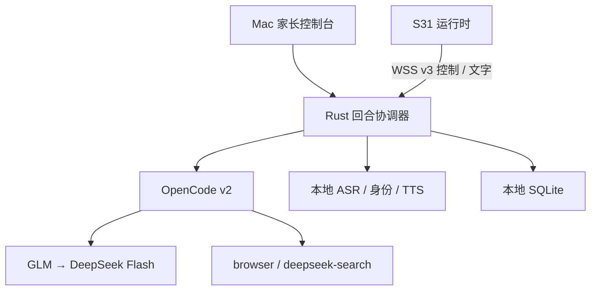

# 小呆 Mac bot-server：OpenCode、多模型、本地声音与记忆

**2026-11-18 小呆大脑：** 普通对话默认由 `server/xiaodai-core` 回答（Luna 优先，GLM、DeepSeek 竞速），工具、任务、私密档案和核心转交的回合仍走 OpenCode。配置项为 `brain_core`，分工、记忆、停止和实测范围见 [验收记录](review-xiaodai-core-2026-11-18.md)。下文第 4 节描述的是 OpenCode 这条路。

**2026-11-16 源码更新：** Mac 已接入家庭日会话、并行 ASR/身份、持续任务与分段呈现，具体配置与迁移见[首次交付](specs/household-companion/implementation-2026-11-16.md)。[第二轮静态审查](review-household-static-2026-11-16.md)进一步修正身份范围、遗忘、取消和呈现等问题，当前均为开发完成、待测试。下方较早日期的构建/实测说明只证明各自旧版本，不验证本次源码。

**2026-11-13 模型选择：** 默认启用 **GLM Coding Plan → DeepSeek Flash**，Qwen Coding Plan 保留但默认停用。旧默认配置的升级范围见 [模型顺序迁移](mac-opencode.md#旧配置的模型顺序升级)。需要更新并重新打开 App 才会应用；此次未构建、运行测试或请求模型。

**2026-11-13 源码修正：** 九项审查问题、分段耗时和语音匹配优化见
[修正与延迟说明](review-fixes-2026-11-13.md)。本次没有运行测试、构建或设备验证。
当前设备 WSS、静默连续问答及图文显示的既有实板记录见
[11 月 12 日验收](specs/server-voice-tasks/acceptance.md)，下方较早日期的记录保留其当时范围。

**2026-11-06 后续本机构建。** 初次交付只包含源码；之后按用户明确要求，已在
Apple Silicon Mac 完成 TypeScript / Vite、Rust release、依赖锁文件解析与 App 打包，
并实际打开控制台、读取用户保存的钥匙串密钥、启动和停止官方 OpenCode v2.2.5。
2026-11-08 的本机测试已尝试真实 Qwen 对话请求，但该端点 TLS 握手超时，未得到模型回复；
GLM 和 DeepSeek 仅完成无凭据的网络连通性检查。Mac 控制台现可复用 RMA 的 Qwen3-ASR
优化 worker，合成中文样本及一次实板语音回合已识别成功；后者通过 GLM 返回并进入板端
播放流程，语音按用户选择在局域网明文传输。当前控制台只保留小呆功能，API Key 可在
“模型与密钥”中配置；详细范围见 [Mac 控制台](mac-console.md)，实测范围和限制见
[整合记录](server-integration-2026-11-08.md)。

## 1. 现在的组成

| 模块 | 实际职责 |
| --- | --- |
| `src-tauri/src/brain` | 主动回合、输入限制、ASR→harness→场景→TTS、取消、配置、Tauri API、WSS 网关 |
| `src-tauri/src/harness` | 官方 OpenCode v2 常驻进程、native HTTP/SSE、会话、权限、模型路由、额度退避和删除 |
| `local-models` | Apple MLX Whisper、SpeechBrain ECAPA、OpenCV YuNet/SFace、macOS 系统 TTS |
| `src-tauri/src/memory` | SQLite 档案、确认后的记忆、声纹/人脸模板、匹配和遗忘 |
| `src/companion.ts` / `capture.ts` | 无设备也可使用的中文控制台、明确点击的录音/拍照、家长管理、回复卡片 |
| `tools/deepseek_search.py` | 可选 DeepSeek 官方 Search / Fetch MCP 适配器；有现有配置时直接继承 |
| `lan-diagnostics` | 默认启用当前固件需要的发现与诊断通道；只读状态由设备页呈现 |



设备仍独占唤醒、注意力、眼睛跟随和物理执行。Mac 返回表达意图、文字、音频和卡片，
不会发每帧瞳孔坐标或舵机角度。仅完整 **小呆小呆** 或明确触摸开启设备交互；
声音能量、脸出现和识别候选不会自动开启对话。

## 2. OpenCode 与模型顺序

查阅并固定适配的官方稳定 v2 为 **2.2.5**。使用 v2 的 `/api/info`、
`/api/session`、`/api/event`、`/api/session/{id}/prompt` 与 `interrupt` 等实际接口，
不会把旧版 `/session/{id}/message` 示例混进来。启动时检查版本，接受兼容的
`2.2.5 <= version < 3`；未来升级仍需要按实际 API 变化维护。

默认顺序写在 `harness/config.rs`：

| 顺序 | 配置路由 | 默认模型 | 凭据环境变量 |
| --- | --- | --- | --- |
| 1 | `glm-coding-plan` | `glm-5.3` | `GLM_CODING_PLAN_API_KEY` |
| 2 | `deepseek-flash` | `deepseek-flash` | `DEEPSEEK_API_KEY` |
| 默认停用，可手动启用 | `qwen-coding-plan` | `qwen3.7-plus` | `QWEN_CODING_PLAN_API_KEY` |

模型名、地区端点、provider ID、enabled 和顺序都可以配置；`base_url: null` 可使用
已经在 OpenCode 中配置的 provider。Qwen Code 的 OAuth 登录不被冒充为百炼 Coding Plan
API key；GLM 国内与国际账户也不混用端点。完整说明见 [mac-opencode.md](mac-opencode.md)。

明确的额度/余额耗尽会触发下一条可用路由；普通 `429` 默认作为限流处理，
不假装知道月度额度已经耗尽。鉴权、模型配置、网络失败分别返回错误。额度状态是
本地退避时间和 provider 提示，**不是剩余额度仪表**。如果工具已经开始执行、产生输出，
或上游是否执行不能确定，不会自动换模型重跑同一回合。

阿里云当前 Coding Plan 文档对自定义应用后端等用途有明确限制。这里保留用户指定的
接法作为默认停用的可选路线；OpenCode 并不会改变套餐适用范围。账户不适用时，应将对应 route
改成该账户允许的普通 API / provider；不要通过改客户端标识绕过限制。
[官方套餐说明](https://help.aliyun.com/zh/model-studio/coding-plan-faq)。
DeepSeek 当前正式 Flash 名称以 [官方 API 文档](https://api-docs.deepseek.com/quick_start/agent_integrations/)
为依据。

## 3. 第一次在 Mac 上准备

以下是新 Mac 的准备步骤。当前 Mac 已安装 OpenCode 并完成桌面构建；文本对话不需要 ESP 板；
本地语音和身份功能需要准备模型环境。Mac 目标是原生 Apple Silicon / M4 Pro 48 GB。

### 3.1 OpenCode 与依赖

按 [OpenCode 接入文档](mac-opencode.md) 安装 **v2.2.5 或兼容的后续 v2**，
不要仅凭旧安装器的 `latest` 名字认定主版本。准备 Node.js、Rust/Tauri 所需的 Mac
开发依赖。原有前端仍使用 `npm ci`，没有增加前端依赖。

`rusqlite`、macOS `security-framework` 与 Tokio/Reqwest 的依赖图已解析进 `Cargo.lock`，
当前 Mac 已实际 release 构建。其他机器可使用锁文件复现；Python requirements 仍需独立准备。

### 3.2 本地模型

以下命令用于首次安装，配置默认写入 `~/小呆 Server/brain.json`。如果旧目录
`~/Library/Application Support/ai.reasonia.espbot.server/` 已有 `brain.json`，
先按第 8.1 节迁移原有数据，再修改配置。

在 `server/bot-server` 目录中：

```bash
python3.11 -m venv local-models/.venv
local-models/.venv/bin/python -m pip install -r local-models/requirements.txt

XIAODAI_MODEL_DIR="$HOME/小呆 Server/models/local"
local-models/.venv/bin/python local-models/provision_models.py \
  --model-dir "$XIAODAI_MODEL_DIR" --only asr speaker face

python3 scripts/configure_mac.py
```

`configure_mac.py` 只写应用配置中的绝对路径、已安装的 OpenCode 可执行文件和系统声音，
保留其他字段并备份已有配置；已有 `models.model_dir` 在未提供 `--model-dir` 时保留，
新配置默认使用 `models/local`。它不会启动模型、录音、摄像头或测试。需要继承指定配置时：

```bash
python3 scripts/configure_mac.py --inherit-config /absolute/path/opencode.jsonc
```

模型下载固定 revision，并校验安装收据。之后的 worker 启动/推理不下载模型。
模型目录与个人数据库分开。系统声音默认 `Tingting`，缺失时如实返回错误，
可换为本机已经安装的普通话声音。详见 [本地模型文档](mac-local-models.md)。

### 3.3 凭据与工具

进入 **模型与密钥 → API Key**，选中服务商后点击 **本次使用**。密钥只在当前 App 进程的内存中保存；停止服务或重载配置后仍可用，完全退出 App 后清除。也可以从带有对应环境变量的进程启动。两者都有时，本次输入优先。Bot Server 不读取、迁移或删除旧版的模型钥匙串条目，也不把输入的模型 Key 写入 JSON、日志或浏览器存储。

服务运行时，更改密钥会在两轮对话之间重启托管的 OpenCode，已连接设备保留 WSS 连接；有正在进行的对话时，先等该轮结束。配置 Key 不等于确认账户可用或额度充足。attach 模式与继承的 provider 继续由外部 OpenCode 管理。 从 Finder 启动的 App 不会自动继承其他终端的 `export`。

`browser` 和 `deepseek-search` 由 OpenCode 的配置加载器继承。缺少时界面显示缺少，
不会虚构可用工具。可选安装方法与 v2 配置示例在
[`tools/README.md`](../server/bot-server/tools/README.md)。DeepSeek Search / Fetch
使用自己的服务计费，与 Coding Plan 模型额度分开。

构建独立 App：

```bash
npm ci
npm run tauri build
open "src-tauri/target/release/bundle/macos/ESP Bot Server.app"
```

开发时使用 `npm run tauri dev`。

App 默认不会自动启动 harness；进入“小呆”页后点启动。
`brain.json.auto_start` 可以在配置后开启。当前只读取 `brain.json`；旧 Chat / Provider、
`config.json` 加载器、Events 及 Mock 界面已经移除，不再有第二套聊天入口。

## 4. 一次互动怎样流动

**文字输入**直接送入回合协调器。**音频输入**必须是已主动采集的 16 kHz、单声道、
PCM16 WAV，最长 30 秒；设备已经有 ASR 时直接提交文字，避免重复转写。
Mac 控制台的麦克风只有点击录音才打开，停止或离开页面就关闭；上传 WAV 也是同一路径。

1. 校验 conversation/turn ID、输入大小与当前服务状态。当前只允许一个 AI 回合，
   避免互相覆盖声音、模型路由与工具授权。
2. 有音频则本地 Whisper ASR；同时可尝试本地声纹候选。声纹不可用不会阻止文字回答，
   以 warning 返回原因。音频及 embedding 不进入 OpenCode。
3. 按本地明确选择的档案召回确认后的记忆；云端路线只取得 `allow_cloud=true` 的记录。
   匿名设备回合只取得适合共享的家庭记忆，不接受设备自报 profile 来解锁个人记忆。
4. OpenCode 负责多模型会话、资料检索和工具调用。小呆 agent 的 shell、文件、子代理等
   能力关闭；需要家长批准的 MCP 动作显示具体请求，只接受本次允许或拒绝。
5. 将返回结果规范为 `speech / expression / cards`。表情有固定枚举，文字有长度限制；
   不渲染模型提供的脚本或 HTML。
6. 请求语音时，调用本地系统 TTS 返回 WAV；控制台或 WSS 网关负责播放/传输。TTS 失败
   仍返回完整文字和场景，并显示具体 warning。

当前采用**完整话语 ASR、回合完成后生成语音**。OpenCode SSE 驱动进度和工具状态，
但这不是已经完成流式边说边答、声学 AEC 或自动打断。TTS 输入最多 1,000 字符，
更长回复在屏幕保留全文，并说明语音截断。没有声称测得首字/首音延迟。

## 5. 屏幕、性格与家长控制

系统提示让小呆用短句、生活例子、小步骤和适量幽默回应孩子，并如实承认不知道。
它不假装家长或真人，不让孩子保密，不通过“不要离开我”等话术制造依赖；
危险或需要大人处理的场景引导找身边可信的人。这是产品提示与权限边界，
不是已测过的儿童内容过滤准确率承诺。

Mac 控制台可呈现文字卡、步骤卡、图片/动图及网页。
图片和网页 URL 必须是后端允许列表内的 HTTPS 主机；默认 `media_hosts=[]`，
未批准的远程媒体降级为文字说明。网页使用无 scripts/forms/popups/same-origin
授权的 sandbox iframe，不获得 Tauri IPC。很多网站本身禁止 iframe，界面不能保证
任何网页都能嵌入。现有 ESP 显示端尚无这个 rich scene player。

家长可以创建家庭成员、明确选择对话身份、管理记忆、登记/撤销人脸与声纹，
批准一次工具操作，停止任务，以及颁发/撤销设备连接凭据。
控制台的完整操作说明见 [mac-console.md](mac-console.md)。
这是同一个本地 Mac 控制台的信任边界，**尚未加入家长 PIN / macOS 用户切换隔离**；
声音、人脸和儿童说一句“我是家长”都不会提升权限。

## 6. 记忆、身份与遗忘

SQLite 中保存家庭/个人记忆、来源、确认状态、允许云端使用、到期时间；
长期正文不会从任意对话中偷偷自动写入。文字历史默认不额外存入 SQLite。
OpenCode 自己会保存会话历史，这与 SQLite 的开关不同。

人脸和声纹在明确同意后各用至少三份不同样本登记，按同一模型和维数进行余弦匹配，
保留 `unknown / ambiguous / low_quality`。匹配不会自动切换对话档案。
阈值是待校准工程初值，没有把分数当成百分比正确率，也没有活体或防录音重放。

修改/删除记忆、撤销云端可见性、删除档案时，先取消活动回合并清理相关 OpenCode
会话上下文，再执行本地变更；清理失败会保留待删除状态并报错。注入上下文变化，
包括下次回合召回时排除到期记录，会让 harness 重建会话，避免沿用旧提示。
到期记录的召回过滤不等于抹除云端服务商或系统备份里的历史副本。
完整 API、字段和删除范围见 [mac-memory.md](mac-memory.md)。

目录/文件使用 `0700 / 0600`；SQLite 没有冒充加密数据库，磁盘保护可由 Mac 的
FileVault 提供。原始输入照片和录音不写入数据库，不给 MCP 工具读取模板的接口。

## 7. 设备接入已经写到哪一层

Mac 新增独立 **WSS v3** 入口，使用 rustls、每台设备的随机 bearer credential、
运行时 token、顺序帧、限长音频缓冲、取消广播与连接撤销。控制连接没有证书时不会
降级；用户选择的语音 PCM 本身通过单独的局域网 TCP 明文传输。
证书准备脚本和控制台凭据功能已经写入，详见 [mac-gateway.md](mac-gateway.md) 和
[shared/mac-brain-v3.md](../shared/mac-brain-v3.md)。

当前 ESP 固件已接入证书/凭据与 WSS v3 控制会话，实板 Wi-Fi 认证连接已建立。明确激活后
按用户选择通过独立的局域网 TCP 连接发送明文 PCM，完整语音回合仍以
[整合记录](server-integration-2026-11-08.md) 中的实测结果为准。诊断 LAN 继续拒绝未认证
的远程请求；BLE 安全配网尚未实现，不会拿 mDNS 发现或软配对冒充密钥认证。

## 8. 配置与数据位置

默认 Mac 配置与工作目录：`~/小呆 Server/`。

| 路径 | 内容 |
| --- | --- |
| `brain.json` | 新主链路设置；只存 key 环境变量名，不存模型 API key |
| `models/` | 显式下载的公开模型、来源和安装收据 |
| `runtime/memory/memory.sqlite3` | 本地档案、记忆与登记特征 |
| `runtime/opencode/` | 路由退避、会话 ledger、生成的 OpenCode 配置与专用工作目录 |
| `runtime/devices/secure-devices.json` | 每设备 bearer 的 SHA256 摘要，不保存原 token |

Server 管理的 OpenCode 运行与工作数据位于该目录下；继承的 MCP、OAuth 与既有全局
OpenCode 配置不会被项目复制进 git。私密运行目录、模型、venv、数据库和 `.env` 都已忽略。

### 8.1 迁移旧安装与恢复未完成的迁移

先退出旧 App，在 `server/bot-server` 目录执行：

```bash
python3 scripts/migrate_data_root.py
```

默认源目录为 `~/Library/Application Support/ai.reasonia.espbot.server/`，目标为
`~/小呆 Server/`。目标目录必须尚不存在。迁移保留原始文件和钥匙串项目，复制本地数据、
模型与引擎，并通过 OpenCode 的 export/import 转移本机器人跟踪的会话。
`inherit_config` 支持 JSON 和含行注释、块注释、末尾逗号的 JSONC；脚本先读取这些
配置，再创建目标目录。路径调整后的副本写成目标目录中的 JSON，原配置文件保持原样。

迁移完成前，目标目录内保留 `.migration-in-progress`。App 和配置助手会拒绝使用该
目录，避免把未迁移完整的数据当成新安装。如果旧版迁移已失败并留下目标目录，先退出
App，将整个未完成目录改名为一个尚未存在的备份名称（例如 `小呆 Server.migration-incomplete`），
然后用修正后的脚本从原始源目录重新迁移。不要只删除标记来强行启动；保留备份，直到
确认新目录的成员、记忆、会话和模型路径符合预期。配置预检查失败且尚未创建目标目录时，
修正提示中的配置后即可直接重试。

## 9. 后续接硬件前的实际缺口

- 配置账户允许的 provider、安装依赖与固定模型、确认本机声音存在。
- Rust 依赖、锁文件和本机打包已完成；仍需在其他目标机器上确认环境兼容性。
- 在 Mac 上实际确认权限弹窗、模型加载、中文 ASR、TTS、取消和 MCP 接线。
- 在到货的 S31 上接通 WSS v3 客户端与本地 runtime 的现有 token/PCM/stop 合约。
- 训练/提供完整 **小呆小呆** 的唤醒模型，完成摄像头方向、音量、AEC 和身份阈值校准。
- 后续的 BLE 安全配网、真正流式 TTS、设备网页/动图播放器与电机适配分别开发。

上述条目保留初次交付的后续计划；最近的实际验证以本文开头和本地模型说明为准。没有运行 CI。
