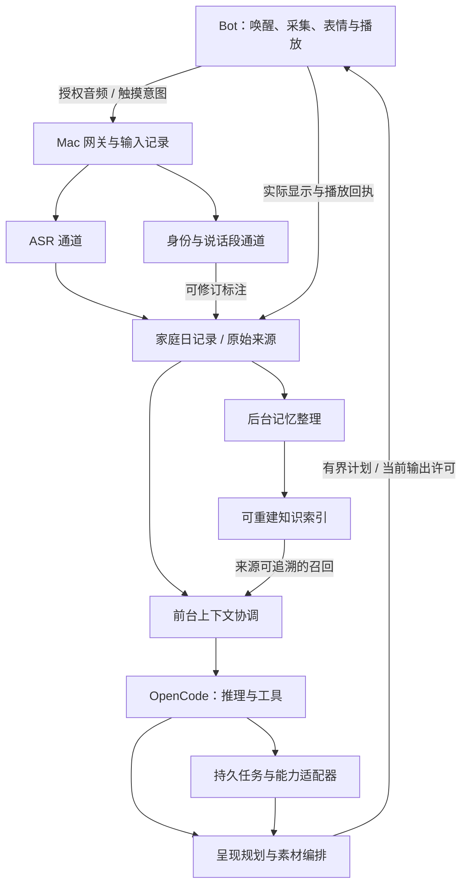

# 家庭陪伴机器人：Mac 后端与持续互动设计

**设计及源码交付日期：2026-11-16。开发基线：`5ae0c780e146a72ebf10f71f4d6976a0ed47e2fe`。**

本规格落实用户确认的产品方向：小呆是服务整个家庭的通用陪伴机器人。教育、一起讨论、创作、查询、娱乐、提醒和打印都是同一能力体系下的场景。Bot 负责敏捷、自然的现场交互，Mac `bot-server` 负责理解、记忆、任务与内容制作。源码接线及配置见[实施记录](implementation-2026-11-16.md)。后续[11 月 16 日本机与实板验收](../../review-household-acceptance-2026-11-16.md)区分已验证的编译、家庭数据、真实语音对话及分段呈现，与仍待测试的 Graphiti、声学打断及真实打印。

## 1. 本次确定的设计

| 决策 | 具体含义 | 约束 |
| --- | --- | --- |
| Bot 作为轻量交互终端 | 本地完整唤醒、单一音频所有者、触摸停止、表情与有界媒体播放；连接配对 Mac | 当前迭代不做设备直连云端 Agent；复杂识别、搜索、排版和推理由 Mac 承载 |
| 音频理解并行 | 授权采集后，同一份音频送 Mac ASR 与说话人识别两个独立执行通道 | 普通提问不等声纹；身份不确定保留未知，迟到结果修订标注，不重放任务 |
| 家庭共享上下文 | 以家庭为命名空间，家庭配置时区内每天一个用户可见会话 | 人物是参与者与知识实体，不按人切割对话；一日会话不意味着麦克风全天开放 |
| 对话、上下文与记忆分层 | 保存可追溯原始记录；OpenCode 做运行上下文 compact；后台整理事件、话题、学习证据与长期知识 | compact 不代替归档和记忆，不以模型摘要冒充原始证据 |
| 复用开源记忆能力 | SQLite 保存权威记录与任务；评估 Graphiti 时序图和混合检索作为可重建索引 | 先完成固定版本、中文、Mac 和模型适配门槛；借鉴 Letta，不引入第二套 Agent 主控 |
| Mac 可执行具体任务 | 独立任务服务管理搜索、媒体制作、打印等能力及其进度、取消和回执 | 任务可跨唤醒、跨天存续；完成后不能自动重新取得设备输出权限 |
| 呈现是核心职责 | `PresentationPlanner` 选择语音、文字、图片、动画、音视频和表情的组合与节奏 | 不要求每问额外串行调用一次 LLM；内容、素材、播放计划和实际呈现证据分开 |
| 先回应，再逐步交付 | 复用本地短应答；长任务根据真实阶段告知正在做什么；有用内容尽早输出 | 不播假进度，不把 ACK 播完误认为整轮结束；取消使旧输出失效 |

这些决定取代旧文档中的设备 Cloud Direct 当前路线、按 profile 切分日常会话，以及必须等身份确认才开始普通回答的假设。现有凭据、权限、个人资料的访问限制不会因改成家庭模型而自动放宽。

## 2. 系统关系

Bot 内部仍只有 `bot_runtime` 决定行为与权限；`bot_bus` 只传递事件。`attention_manager` 的单一视觉焦点不等于家庭会话只能有一个参与者。Mac 发送语义表情和内容计划，眼睛插值、音频时钟、停止和有效期检查留在设备。

## 3. 必须分开的生命周期

| 对象 | 标识 | 生命周期与用途 |
| --- | --- | --- |
| 家庭 | `household_id` | 长期知识、成员与配置的归属，由可信宿主确定 |
| 日记录 | `daily_conversation_id` | 家庭时区内一天的逻辑会话；按话题/事件分段，可关联跨天主题 |
| 对话片段 / 轮次 | `episode_id` / `conversation_turn_id` | 可追溯的交互内容；模型失败、取消也保留相应事实与状态 |
| 原始话语 / 说话段 | `utterance_id` / `speaker_segment_id` | 音频时间范围、ASR 修订、候选身份、人工标注和来源证据 |
| 设备激活 | `activation_id` | 明确唤醒/触摸产生的临时输入授权；结束即关闭采集上传 |
| 固件仲裁令牌 | 现有 `RuntimeToken` | `epoch/session_id/turn_id/focus_generation` 原义保持；其中 `turn_id` 不是 `conversation_turn_id` |
| 执行任务 | `task_id` | 可取消/恢复的 Mac 工作；不依赖当前激活一直开放 |
| 呈现与播放 | `presentation_id` / `playback_id` | 不可变计划版本与一次实际播放尝试，允许重访同一素材 |
| 设备输出许可 | `output_lease_id` | runtime 接受的有限输出权；任务完成、重连和新唤醒不会自动续领 |

表中 ID 属于分层领域模型，不会全部直接发送给设备。当前 WSS 以 `presentation.segments.v1` 协商呈现/片段/输出许可，保留原 runtime 仲裁及旧端单次回复。精确线格式见 [固件接线记录](../../../firmware/HOUSEHOLD_INTEGRATION.md)；详细领域约束见 [设备与音频](device-and-audio.md) 及 [模块契约](../../module-contracts.md)。

## 4. 设计时的基础与缺口（历史快照）

此节记录设计对照提交 `90972a37530b68b8c8c9729960ac15e901c9d946` 的观察，保留开发拆分原因。**表中“待开发”不代表当前状态**；对应接线、未部署依赖和未执行验收以 [实施记录](implementation-2026-11-16.md) 为准。

| 领域 | 设计时基础 | 当时待开发范围 |
| --- | --- | --- |
| 设备互动 | 完整词 MultiNet7 唤醒、104 条本地语音、表情、触摸停止、token 和真实音频完成回执 | 任务内 ACK/progress 与最终回答分离；媒体能力预算；AEC/语音打断 |
| Mac 理解 | 本地 ASR/TTS、ECAPA 声纹及人脸登记/候选代码、OpenCode harness | ASR/身份真正并行；多人分段；阈值与真实家庭环境验收 |
| 上下文 | OpenCode 会话映射、可取消调用、记忆召回 | 家庭日会话映射、稳定上下文、compact 协调；修复 [#9](https://github.com/JasonGuoo/esp-bot/issues/9) |
| 数据 | SQLite profiles、memory、conversation 和本地记忆 worker | 家庭事件源、原文先落盘、关系/主题/学习证据、可传播修订、Graphiti 派生索引 |
| 呈现 | 受限卡片、JPEG 与 TTS 通路、已存在显示证据检查 | 分段语义计划、不可变素材、音画同步、音视频来源、实际交付回执 |
| 任务与控制台 | 单个活跃回合、工具权限事件、停止入口、成员和记忆管理 | 脱离全局 turn gate 的持久任务、家庭时间轴、逐段身份标注、打印适配器 |

设计基线中的 `brain/mod.rs` 先 ASR 后声纹，而当时 `brain/worker.rs` 的单进程锁不能通过简单 `join` 获得并行。原文历史在图片/TTS 后才追加，失败轮次可能缺失；`image_prepare` 又可能改写 speech，直接并行生成会造成音画内容不一致。这些是开发拆分的实际依据，不能只改提示词解决。

## 5. 规格与开发入口

| 文档 | 回答的问题 |
| --- | --- |
| [设备与音频](device-and-audio.md) | Bot/Mac 职责、并行 ASR/身份、音频时序、多人、AEC 与取消 |
| [家庭记忆](household-memory.md) | 一日会话、来源模型、Graphiti 映射、异步整理、迁移、纠错与遗忘 |
| [呈现与任务](presentation-and-tasks.md) | 思考层、素材、语音/视频/表情、真实进度、持续任务和打印 |
| [开源记忆调研](../../research/household-memory-open-source-2026-11-16.md) | Graphiti、Letta、Mem0 的实际边界、版本与采用理由 |
| [实施记录](implementation-2026-11-16.md) | 本次源码接线、配置、依赖及未执行项目 |
| [实施计划](implementation-plan.md) | HC-01～HC-15 的依赖、逐步开发内容与待执行验收 |
| [总跟踪 issue #13](https://github.com/JasonGuoo/esp-bot/issues/13) | 已建立的 #14～#28 工作清单与开发完成待测试状态 |

## 6. 第一条完整体验

第一条主线为：孩子唤醒并提问 → Bot 简短回应 → Mac 并行识别并立即理解问题 → 家长加入同一话题 → 小呆以声音、图解和表情逐步说明 → 明确要求时打印同一份素材 → 后台保存事件、来源和学习证据 → 第二天接着问能找回对应话题与图文。

先让这条主线在当前半双工能力下成立，再扩展多人重叠说话、AEC 和复杂视频。打印、记忆等后台工作不能挡住下一次唤醒；“家庭记忆”不能以永久开麦作为实现方式。实际开发按 [阶段与步骤](implementation-plan.md) 推进，每次交付分别说明源码、构建、本机运行和实板验收情况。**不新增 CI、不以缺少硬件为由阻止可完成的源代码开发。**
