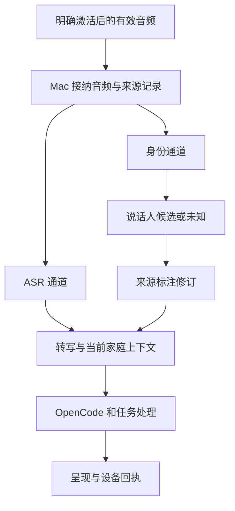

# 设备与声音：轻量终端、并行理解和可追溯的说话人

设计与源码交付：2026-11-16。**源码开发完成，待测试。** 本文保留[家庭陪伴设计](README.md)的职责与验收契约；实际接线、配置及限制见 [实施记录](implementation-2026-11-16.md) 和 [固件接线记录](../../../firmware/HOUSEHOLD_INTEGRATION.md)。本轮未编译、未运行模型、未执行 Mac GUI 或实板验收，没有 CI。[2026-11-15 验收](../../review-acceptance-2026-11-15.md) 对应旧版本，不能证明本轮识别、播放或 AEC 效果。

## 1. 设备承担即时互动，Mac 承担理解和工作

| 能力 | ESP32-S31 Bot | Mac bot-server |
| --- | --- | --- |
| 激活与即时反馈 | 完整「小呆小呆」或明确触摸激活；复用 104 条本地应答；表情、字幕、静音、停止 | 提供后续任务接纳、实际进度和回答；管理可缓存素材 |
| 音频 | 唯一 codec / 麦克风 owner；有界 VAD、同 token 起音缓存、采集和播放；本地权限仲裁 | ASR、声纹候选、多人分段、TTS、媒体转换和模型管理 |
| 人与环境 | 当前预算内的轻量观察、眼神位置和表情插值；不由人脸或声音能量启动对话 | 身份匹配、关系、记忆、语义理解；复杂视觉处理 |
| 任务和呈现 | 校验能力、令牌和资源预算，播放声音、显示准备好的内容，返回实际设备回执 | OpenCode、检索、工具、打印、呈现计划、资源归档、后台整理 |
| 网络 | 连接配对 Mac 的局域网服务，沿用当前认证控制和媒体通道 | 管理云模型、搜索及工具连接；设备不直接访问这些服务 |

本轮不增加设备独立云端 Agent，不把家庭记忆、ASR、声纹模型、网页排版或视频转码下放到 Bot。`bot_runtime` 继续是设备行为、会话和输出的唯一权威；Mac 只发经协商的语义请求。`face` 渲染，`attention` 规划眼神，服务器不逐帧控制瞳孔或不存在的电机。现有板子仍无已安装的舵机和 IMU。

空闲时只保留本地唤醒所需的麦克风处理，不持久化、上传未激活环境音。家庭当天共用一份记录不延长麦克风授权。唤醒响应、任务进度和播放结束也不能自行创建新一次激活。

## 2. 设计时源码基线（历史快照）

下表保留提交 `90972a37530b68b8c8c9729960ac15e901c9d946` 的拆分依据，不是当前源码缺口。当前已接独立 worker 通道、来源修订、用途明确的分段播放和实际 DAC 参考；其运行状态仍待验收。

| 基线入口 | 设计时行为 | 当时要求的变化 |
| --- | --- | --- |
| [`brain/mod.rs`](../../../server/bot-server/src-tauri/src/brain/mod.rs) 的 `execute` | 先等待 ASR，再做符合条件的声纹检查，之后才进入回答流程 | 音频完整接纳后交给独立 ASR 与身份处理通道；普通问题先按转写继续 |
| [`brain/worker.rs`](../../../server/bot-server/src-tauri/src/brain/worker.rs) 的 `call_at_generation` | 单个 Python 进程槽由 `try_lock` 保护；并发调用返回 `local_worker_busy` | 复用现有监督、取消和超时机制，分离有界通道与进程；不能只把两次调用改成 `join` |
| [`local-models/worker.py`](../../../server/bot-server/local-models/worker.py) | ECAPA 对整段录音产生 192 维 embedding；质量结果明确 `single_speaker_verified=false` | 整段结果仍是候选；多人分段单独实施，不能把能量检查当作单人证明 |
| [`brain/gateway.rs`](../../../server/bot-server/src-tauri/src/brain/gateway.rs) | 当前设备激活有自己的 `Engagement` / `conversation_id`，终态设备格式不承载完整身份候选 | 家庭日记录与激活映射分离；Mac 事件和档案界面独立接收身份修订 |
| [`bot_audio_afe.c`](../../../firmware/components/bot_audio/bot_audio_afe.c) | `aec_init=false`；播放和尾音期间有输入隔离 | 保留半双工可用路径；AEC 和播放中语音打断作为 HC-14 单独交付 |
| [`bot_runtime.c`](../../../firmware/components/bot_runtime/bot_runtime.c) | 本地应答结束回 `LISTENING`，远端最终播放结束可 `arm_followup` | 任务 ACK / 进度播放必须有自己的用途和结束语义，不能误触发下一轮 |

上表是历史源码判断，不表示本次声纹依赖、Mac 多模型并发或远场识别已经运行通过。ASR 的某些现有适配返回整段文本且 `segments=[]`，因此不能假定已经有可用于精确对齐说话人的字词时间戳。

## 3. 处理流程和资源调度

图中“标注修订 → 上下文”仅用于后续合法读取；不得因为身份晚到而重新执行已经开始的用户任务。

第一阶段可以继续在当前 `audio.commit` 后处理完整有界录音，同时启动两条 Mac 通道，不先承诺流式 ASR。后续按模型适配能力增加分段转写；部分转写必须带稳定修订和明确 final 标志，不能把易变 partial 文字直接当作打印等外部动作的最终输入。

下列步骤保留实现约束；当前来源/worker 接线已完成，最后的时序与资源测量尚未执行。本轮不建立原始录音档案，来源页明确 `audio_available=false`；下述音频留存策略是扩展边界，不能据此声称现有录音可回听。

1. **接纳一次输入。** 校验完整流、序号、格式和授权，为音频分配稳定 `utterance_id`，先写来源记录，再投递识别。两条通道引用同一不可变音频版本；不得分别把稍有差异的缓存当作同一句。原始字节是否落盘由录音留存设置决定。
2. **分离 worker。** ASR 与身份拥有各自的进程槽、加载状态、有限队列、取消代次和超时。复用现有 worker supervisor；不要保留共享 `try_lock` 后声称并行。TTS、后台记忆和媒体处理也要参与宿主资源调度，避免身份任务占满 CPU 或统一内存使首个回答变慢。
3. **ASR 优先交付。** 收到合法 final 转写后持久化文本和语言、模型、版本、可用时间信息，立即驱动普通回答。无声、残缺或过长输入返回明确结果；短句可正常问答，不因为不足以识别说话人而拒绝。
4. **身份异步补充。** 已登记模板存在且质量足够时计算 embedding 与候选。没有模板、样本太短、多人重叠、模型缺失、忙或超时分别保留原因。身份结果不决定是否启动普通家庭问答。
5. **约束迟到结果。** 写入带来源版本的身份修订；若来源已删除或撤销则拒绝写回。正常任务结束后仍可在来源保留政策内完成标注，但不能抢回旧输出许可，也不能重新播报、重跑工具或把当时未授权的操作改成“已授权”。
6. **测量真实收益。** 记录音频接纳、ASR 开始/完成、身份开始/完成、首个有用响应、首音和首帧；区分冷启动与已加载模型。并行的验收目标是身份任务不串在回答关键路径上，具体延迟与并发容量由用户 Mac 实测决定。

若未来 ASR 使用增强信号而声纹使用另一种信号，两者仍必须引用同一采集区间，并记录变换版本、采样率和样本偏移。不得把设备当前标记的 `enhanced=false / echo_cancelled=false` 擅自改为已增强或已去回声。

## 4. ID、来源与时间的契约

下列字段说明已接入的**服务端领域模型**，不全部透传给设备。设备仍使用原 `RuntimeToken`，分段呈现以 `presentation.segments.v1` 协商；实际字段以 [v3 协议](../../../shared/mac-brain-v3.md) 和 [固件接线记录](../../../firmware/HOUSEHOLD_INTEGRATION.md) 为准。

| 标识或时间 | 作用与生命周期 |
| --- | --- |
| `household_id` | 由已认证设备与家庭配置在 Mac 端确定，不能相信客户端任意指定的家庭 |
| `daily_conversation_id` | 家庭配置时区内的当天共同记录；多次唤醒、多位参与者都追加到此记录 |
| `episode_id` / `conversation_turn_id` | 有界话题片段与来源轮次；领域模型用 `conversation_turn_id` 避免与现有服务端字符串 `turn_id`、设备 token 内的数字 `turn_id` 混淆，迁移时保存映射 |
| `activation_id` | 一次明确唤醒或手动激活的服务端记录，映射当次 runtime 授权；结束后不再允许上传，不结束当天记录或独立任务 |
| `utterance_id` / `speaker_segment_id` | 一次音频输入及其稳定的说话区间；重跑模型新增 revision，不改写原始来源身份 |
| `task_id` | 已接纳的工作，可跨激活和跨日；与每次音频播放或识别请求分开 |
| `presentation_id` / `playback_id` | 某一版本的呈现及具体播放；模型生成完成、网络传输完成和硬件播放完成分别记录 |
| `output_lease_id` | 本次输出许可，绑定设备、连接、运行时令牌和用途；工作完成不自动续租 |
| `RuntimeToken` | 现有 `epoch / session_id / turn_id / focus_generation`，只承担实时设备仲裁，不作为永久家庭会话 ID |
| 样本区间 | 使用原始流内的 `start_sample / end_sample` 与采样率描述区间，明确端点规则、丢帧和重采样映射 |
| 时间 | 分别保留可用的设备单调观察时间、Mac 接收时间、事件发生时间、记录时间、时区与时间质量 |

当前 `bot_audio.h` 的 `observed_us` 是读完成或事件被观察的本地单调时间，**不是硬件采样时间，也不与 Mac 的墙上时钟直接相减**。当前服务端已记录输入区间和身份片段样本范围，但没有可靠的设备采集 UTC 映射；音频分日使用服务端接收时间，并保留 `time_basis=server_received`、`occurred_time_uncertain=true`。设备重启有新的时钟 epoch；跨午夜真实采集对齐仍需实板验收，不能将接收时刻冒充采样发生时刻。

身份结果至少区分：`unknown`、`insufficient_audio`、`candidate`、`confirmed`、`overlap`、`unavailable`。保留模型标识、模板版本、原始分数、质量原因、来源区间及人工修订来源；模型分数不标成统计正确概率。`confirmed` 来自明确的标注或登记政策，不由“最高分”自动变成人工确认。说话人、话中提及的人和操作授权主体是三个字段；例如爸爸说“小朋友喜欢恐龙”，不能把爸爸写成偏好主体。

取消要针对识别请求、任务、播放或整个激活的明确范围。各通道使用独立 generation 和请求 ID，不能因为取消一个迟到的身份请求而杀掉另一任务的 TTS。全局停止仍能统一收回当前激活及其输出权限，具体长任务是否一并取消由明确操作范围决定。

身份用于家庭参与者标注和合适的后续称呼，不为不同人另建对话筒仓。普通会话中从爸爸换到孩子不旋转当天 OpenCode 对话。明确访问限制、撤销或遗忘仍需要单独的上下文失效机制，不能借家庭共用之名取消原有约束。

## 5. 多人说话和人工标注

HC-03 的并行和候选入库、HC-13 的说话人分段与重叠检测适配已接线，复用 [pyannote.audio](https://github.com/pyannote/pyannote-audio) 和官方 [Community-1 模型](https://huggingface.co/pyannote/speaker-diarization-community-1)。上游提供说话区间和用于转写对齐的 exclusive diarization，但匿名 speaker label 不等于家庭成员身份。Mac 的中文、儿童语音、多人抢话、CPU / Apple Silicon 部署效果需要本项目实测；模型获取条件单独处理，本次源码交付没有下载、安装或运行模型。

实施时保留原重叠区间，不把 exclusive 结果当作只有一个人在说话的证据。对足够长且质量合格的单人片段使用现有 ECAPA 模板比对；不同模型的向量不混在同一个模板空间。无法可靠分配的内容保留“未知 / 多人 / 无法确定”，需要时由 bot-server 标注界面修订。

Mac 家庭来源页已将转写、说话区间、候选、证据和最终标注放在同一视图，支持改标、标为未知、撤销人工覆盖和查看修订；成员合并是独立确认入口，不混训模板。手工拆分/合并声学区间和原始录音回听仍是后续扩展，本轮不把自动区间或无录音来源冒充可编辑/可回放证据。人工确认普通对话的说话人不自动把整段家庭录音登记为新声纹模板。修订后按来源依赖更新相关记忆，不重放原来的任务或语音回答。具体日记录和记忆传播见[家庭记忆](household-memory.md)。

## 6. 先应答、再处理：播放用途必须分开

复用已有 104 条素材和表达枚举，在 Mac 管理场景标签、冷却、夜间偏好及可选缓存。设备只执行 runtime 许可的短反馈。时间不可信时使用中性素材；不能靠人脸或周围声音推断有人请求了任务。

| 当前播放用途 | 允许的触发 | 播放结束后的目标状态 |
| --- | --- | --- |
| `wake_ack` | 明确激活；如“我在” | 在原激活下等待真实采集就绪；仍遵守尾音隔离 |
| `task_ack` | Mac 已接纳任务且尚无可立即交付的答案 | 返回同一任务的等待 / 思考状态，不分配新输入轮次 |
| `progress` | 真实任务阶段变化，且本次输出许可仍有效 | 返回原任务状态；不声明任务完成、不续麦克风许可 |
| `content` | 已冻结的回答片段及资源 | 根据呈现计划接续下一片段，不提前启动下一次输入 |
| `final` | 当前呈现最后一个有效片段 | 按原有明确策略进入追问准备或结束；保留独立阅读许可 |
| `preview` | 声音设置中用户主动试听 | 只结束试听，保持没有会话 / 麦克风 token |

当前源码已将播放用途与来源分离。受管片段的硬件 DONE 返回思考态，ACK/进度不准备追问；最终片段也必须等所需显示、音频和停留回执成功后，由呈现完成命令准备下一轮。失败片段关闭本次输出，不冒充成功或自动续麦。快速答案到达时撤销尚未播放的 ACK；唤醒确认和任务确认去重。真实进度来源是 ASR、工具、图像准备、TTS 或打印适配器事件，不生成模型的内部推理播报。

首个有意义的等待提示可从 5–8 秒起试，后续语音间隔从至少 15–20 秒起试并优先使用真实阶段变化；这些是调参起点，不是已测指标。心跳不代表任务有进展。取消、关闭、断线或新交互先撤销旧输出许可，迟到 ACK、音频和图片都不得改贴新 token。详细呈现编排见[呈现与任务](presentation-and-tasks.md)。

## 7. AEC 与语音打断：源码已接，默认关闭

当前半双工路径保持可用：输出及尾音清理时不保证识别“停止”，触摸停止始终有效。HC-14 不能仅打开 `aec_init` 就宣称完成全双工。

本轮已核对 [S31 AFE 官方输入格式](https://docs.espressif.com/projects/esp-sr/en/latest/esp32s31/audio_front_end/README.html)、GMF S31 AEC 示例及固定 codec/BSP 接口。单一 ES8389 owner 可选采集同帧 `MRMN` 四槽：麦克风、实际 DAC 参考、第二麦克风、空槽，再交给 ESP-SR AFE；不是用计划中的 TTS 文本或猜测延迟的软件缓冲冒充参考。`CONFIG_BOT_AUDIO_HARDWARE_REFERENCE_AEC` 和 `CONFIG_BOT_AUDIO_AEC_BARGE_IN` 均默认关闭。参考有效性、格式、内存、AFE 积压、静音及持续残余语音共同门控；初始化失败保留半双工回退。参数、官方接口与验收边界见 [固件接线记录](../../../firmware/HOUSEHOLD_INTEGRATION.md)。实际增益、尾音、时钟漂移和双讲性能没有测量。

允许比较板端 AFE 与 Mac 处理，但须给 Mac 保留与采集对齐的实际播放参考及丢帧信息，不能只拿“计划播放的 TTS 文本”当参考。优先复用成熟模块，不自行实现声学算法。验收至少区分自身播报不触发、用户短句打断、双人重叠、不同音量与距离、网络抖动和参考丢失；失败回到明确的半双工模式，保留停止按钮。

## 8. 失败边界与阶段验收

| 情况 | 必须保留的行为 |
| --- | --- |
| Mac 离线 | 完整唤醒、本地应答和既有固定控制可用；清楚提示后端不可用，不伪造自由回答 |
| ASR 成功、身份失败或慢 | 普通问答继续，来源暂为未知；独立显示身份失败原因 |
| 仅有很短一句话 | 允许理解有效意图；不强行给出人名，不强迫重说只为了声纹 |
| 两个人接连说话或抢话 | 同属家庭记录；不把整段都当成一个确认的人，不猜测被遮住的话 |
| 用户停止后 worker 才返回 | 不输出、不执行已取消任务；来源允许保留时仅按版本和留存政策处理标注 |
| 家长已删来源后旧结果到达 | 拒绝写回，避免重建已遗忘的来源或派生记忆 |
| ACK 后真正结果到达 | 继续原任务和原许可的有效呈现；ACK 结束不把任务转成下一轮 |
| 长任务跨日或设备离线 | Mac 可依任务政策继续工作并归档结果；不自动恢复旧设备收音或扬声器 |
| 只有网络 / 模型完成事件 | 不标为已经播出；播放、文字和图片仍由各自实际回执确认 |

HC-03 的交付记录需给出 ASR / 身份并发时序、短语音和身份失败的真实行为；HC-06 要验证播放用途、排队 ACK 取消及 token 隔离；HC-13 要记录多人样本的来源标注准确性和未知比例；HC-14 要记录真实扬声器播放时的打断与误触发。HC-15 汇总家庭共同话题、持续追问和图文语音任务的设备体验。

遵守项目 no CI 政策。上述是本次源码的待执行验收条件；本轮没有安装模型、运行推理、编译、刷机或执行实板测试，后续记录必须分别说明源码、构建、模型运行和实板验证的实际范围。
