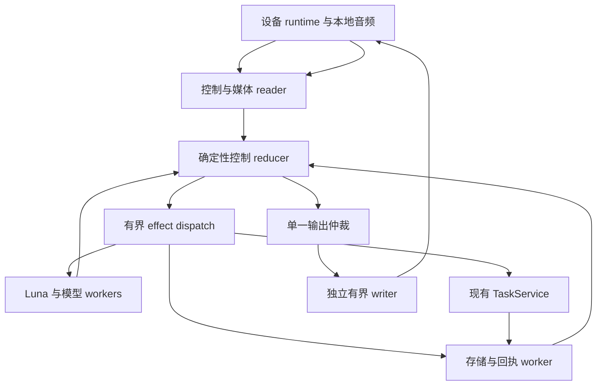

# 始终可回应的助理：目标架构

**状态：设计提案，未实现、未运行本规格的测试。日期：2026-11-25。** 源码核对基线为 `46ecdfbd99eba8e9158f8953b9ca251a45bc1d92`。总事项、实施顺序与状态以[本规格入口](README.md)和[总 issue #36](https://github.com/JasonGuoo/esp-bot/issues/36)为准。本次只交付文档；下文的新增模块、接口、配置和模型均为拟议。

## 1. 要解决的问题

小呆需要在模型、工具、存储或网络慢的时候仍能接收本地操作、停止输出、更新可见状态，并诚实地说明任务是否接纳、是否仍在执行。普通聊天、后台工作、结果播报与身份补充应有各自的生命周期。

这不是再增加一个“快模型”。Luna 已是异步生产者：[`Core::start_messages`](../../../server/xiaodai-core/src/core.rs) 已 `tokio::spawn(drive(...))`。现在的耦合主要在外部控制路径。

| 已核对的现状 | 带来的限制 | 本规格改变 |
| --- | --- | --- |
| [`gateway.rs`](../../../server/bot-server/src-tauri/src/brain/gateway.rs) 在连接循环内等待 socket 写入、`finish_plain_input`、本地 producer 的 `stop().await`，并直接调用同步存储接口 | 这些等待期间，同一连接的其他控制事件可能得不到处理 | reader、writer、媒体处理、存储和 cleanup 移到有界执行通道；控制只处理事件与有限状态 |
| [`gateway/segments.rs`](../../../server/bot-server/src-tauri/src/brain/gateway/segments.rs) 的 `Delivery.tasks` 同时影响 final 与完成判定；普通输入以 `delivery.is_some()` 判忙 | 持久任务可能占住前台入口，任务完成和本轮答复完成混在一起 | 分离 foreground turn、durable task、result delivery 和 output lease |
| [`tasks.rs`](../../../server/bot-server/src-tauri/src/brain/tasks.rs) 已有 SQLite、任务状态、有限调度槽、输出 lease 和真实回执 | 可复用，但同步数据库调用和结果交付还需从控制循环移出 | 扩展现有 `TaskService`，增加持久结果 inbox 和非阻塞适配，不再建任务调度系统 |
| [`fast_core.rs`](../../../server/bot-server/src-tauri/src/brain/fast_core.rs) 禁止 Luna 使用工具，通过 `〔转交〕` 路由 OpenCode | 内部声纹、提醒等代码不自动成为对话可发现、可调用的能力 | 由统一 registry 描述能力；模型只提出结构化动作，宿主验证、执行并给可信回执 |
| [`worker.rs`](../../../server/bot-server/src-tauri/src/brain/worker.rs) 已有独立模型通道；ASR 与身份并行 | 不能因已有异步任务就推断主循环无阻塞 | 保留现有 lane，逐个审计其调用方、锁、队列、事件发布及取消边界 |

现有[系统架构](../../architecture.md)、[模块契约](../../module-contracts.md)、[家庭规格](../household-companion/README.md)仍适用；本文件细化下一阶段的交互控制。

## 2. 保证的范围

**控制决策不等待任何后端，包括 Luna。** 控制线程可以等待事件、唤醒通知或本地定时器；处理一次事件时，不等待 LLM、ASR、身份、TTS、SQLite、文件、网络、异步锁或任务退出。不在控制路径执行大段 JSON/base64/媒体处理，也不调用可能阻塞的日志 sink 或用户回调。

这是有界、确定性的对话控制设计，**不是硬实时系统保证**。实际延迟仍受 OS 调度、设备负载、驱动、网络和音频尾巴影响。验收分别记录逻辑进展、Mac 控制调度、设备实际停止/反馈以及真实语义回答；不使用模型首 token 延迟替代端到端交互延迟。

后端全部挂起时，设备仍应能停止、显示离线或等待状态、播放现有本地短反馈，控制层仍能接收明确的协议操作。它不能据此承诺理解任意新语句，更不能在 ASR 未完成时假称听懂“取消刚才的打印”。固定按钮、触摸 Stop、明确 task handle 和已解析的控制指令具有独立路径。

**半双工继续是默认。** 接纳新前台输入仍服从设备 `bot_runtime` 的收音许可、token、音频尾部清理与 `capture-ready`。后台任务并行不等于播放中打开麦克风；声学打断需独立完成真实参考 AEC 与实板验收。

## 3. 参考设计与复用边界

主循环的主要参考是 AIRI 的 pure Policy：把状态、事件、命令分开，模型只是外部异步信号。再取 TEN 的执行隔离和 Pipecat 的控制优先级，适配到现有 Rust/Tauri 和设备 runtime。以下来源查阅于 2026-11-25，固定修订及在线文档的版本边界见[研究依据](research.md)。

| 上游证据 | 借鉴的机制 | 不作的推论 |
| --- | --- | --- |
| [AIRI voice input ADR](https://github.com/moeru-ai/airi/blob/68b35a7b4e7f90fb5e3d6bcbe98c98b17c1cfa9f/docs/ai/adr/2026-10-16-voice-input-layers.md)、[core-agent README](https://github.com/moeru-ai/airi/blob/68b35a7b4e7f90fb5e3d6bcbe98c98b17c1cfa9f/packages/core-agent/README.md) | `state + event → state + commands`；慢信号带读取版本；过期结果拒绝；设备中断与语义决策分离 | ADR 中的迁移状态不等于所有场景已经成熟；未测量它与本项目的速度排名 |
| [TEN concept overview](https://theten.ai/docs/ten_framework/concept_overview)、[Extension 文档](https://theten.ai/docs/ten_framework/software_packages/extension) | 用线程/进程隔离执行；回调返回后以消息提交结果 | ExtensionGroup 共享线程可能互相拖慢；事件图本身没有证明本项目所需的队列上限和 Stop 优先级 |
| [Pipecat FrameProcessor 固定源码](https://github.com/pipecat-ai/pipecat/blob/b1256409cd5e3d670465540f5d5c469b48d0e73b/src/pipecat/processors/frame_processor.py)、[interruptions](https://docs.pipecat.ai/pipecat/fundamentals/interruptions) | 系统帧优先于普通媒体/业务帧；打断要清理生成、队列和播放；记录实际播出的内容 | asyncio task 不等于线程隔离；该源码不构成本项目有界队列证明；其取消等待不能照搬进控制处理器 |
| [LiveKit asynchronous tools](https://docs.livekit.io/agents/logic/tools/async/) | 工具可在释放当前对话后回报进展和结果 | 会话内异步工具不自动提供跨进程崩溃、跨天恢复或本项目的持久 inbox |

这些是设计依据，不是引入 AIRI/TEN/Pipecat/LiveKit 运行时的计划。继续使用现有 Luna、OpenCode、`TaskService` 和 SQLite；不引入第二套 Agent runtime。

## 4. 所有权与执行边界

| 所有者 | 拥有的状态 | 允许等待的位置 |
| --- | --- | --- |
| 设备 `bot_runtime` | 激活、麦克风许可、本地 Stop、播放资源、可见设备状态 | 既有本地调度契约；不能等 Mac 才停止本地音频 |
| Mac control reducer | 连接/激活代际、前台轮次、请求接纳、输出权限、有限计时器——均为设备权威状态的**镜像** | 纯事件转移不等待；不拥有数据库连接或 provider handle；只能收窄（fence、拒绝、撤权），不能放宽 |
| control runtime / dispatcher | 有界 mailbox、优先级、dispatch 回执、监督信息 | 顶层等事件；投递使用非阻塞操作，队列满转成显式事件 |
| gateway reader/writer | 协议解析、transport、帧上限、发送与网络超时 | 各自 I/O worker 内等待；writer 堵塞不占 reducer 或 reader |
| Luna worker | 既有快核心、家庭会话顺序、stream、路由/退路 | worker 内等待模型和会话锁；不会把锁带进 control |
| TaskService / capability adapters | 耐久任务、能力执行、效果证据、操作幂等 | 有限 worker 内等待；CPU/同步库使用受限线程或进程隔离 |
| storage worker | SQLite 短事务、版本、持久结果 inbox、事实回执 | 存储执行域内等待；控制只读已发布的不可变快照 |
| output arbiter | 当下谁可说、播放尝试、对应的实际回执 | 仲裁决策不等待；TTS、媒体准备、网络发送另行执行 |

`tokio::spawn` 只是必要机制之一。若其内部运行同步 SQLite、长 CPU 计算或阻塞第三方调用，仍须迁入有并发上限的 blocking executor/独立进程，并防止其耗尽控制所需的执行资源。不能以“所有函数都是 async”作为隔离验收。

**Mac 永不放宽设备许可。** Mac reducer 的 activation/turn 状态只是 `bot_runtime` 权威状态的镜像：它可以 fence、拒绝或撤销，但不能开启采集、延长 RuntimeToken、授予设备未请求的播放，也不能把旧 token 换贴到新轮。两端不一致时以设备 RuntimeToken 为准，Mac 收窄到一致。RA-01 的 `ResponsiveControl` 模型以 `MacNeverWidensDeviceAuthority` 检查这一点。

建议新增位置为 `brain/control_contracts.rs`、`brain/control.rs`、`brain/control_runtime.rs`、`brain/control_dispatch.rs`；gateway I/O、Luna、结果 inbox 各在后续步骤列出最小模块。均为**拟议新增文件**，本次不创建代码占位。

## 5. 统一事件、版本与可信来源

拟议 `EventEnvelope`：

| 字段 | 规则 |
| --- | --- |
| `event_id`, `request_id` | 宿主生成、去重和请求关联；内部计时器可无 `request_id` |
| `service_epoch`, `origin`, `origin_seq` | 重启隔离、可信生产者、该生产者的有界序列检查；不假设不同连接或 worker 的全局顺序 |
| `foreground?: ForegroundRef` | `{ connection_epoch, activation_id, runtime_token, turn_id, generation, input_revision }`；只约束当前前台输入/输出，不作为任务寿命 |
| `operation?: OperationRef` | `{ operation_id, operation_revision, task_id? }`；独立于前台代际，关联持久调用和工作流 |
| `output?: OutputRef` | `{ output_lease_id, playback_id, segment_seq }`；一次输出尝试的权限与实际回执 |
| `deadline_mono?`, `payload` | 本进程单调时钟截止点；负载经大小限制和类型验证，PCM/大结果只传受限引用 |

**分阶段冻结。** 上表是完整目标；各子引用在首次消费它的步骤中冻结：RA-00/RA-01 只需 `foreground`（RuntimeToken 与 generation）和 `output`（lease）；`operation` 以及 task/operation/result/delivery 四类修订随 RA-04/RA-05 引入。不预先填充尚无所有者的字段，也不用占位值通过检查。

复用 [`contracts.rs`](../../../server/bot-server/src-tauri/src/brain/contracts.rs) 的 `SourceRef`，包括家庭、日记录、episode、turn、utterance 和 `source_revision`。`ForegroundRef.input_revision` 是采集/提交修订，不能替代持久来源版本；RA-06 中拟议的 `TaskRecord.input_revision` 则描述任务要求的版本，两个字段即使同名也不可混用。`task_revision`、`operation_revision`、`result_revision`、`delivery_revision` 分别裁决任务、调用、冻结结果、交付状态；不能互相借用来通过检查。

墙钟用于用户要求的日期、时区和持久提醒；单调时钟用于本进程的控制超时。跨重启不能恢复旧 `Instant`，设备和 Mac 的 monotonic 值也不能直接相减。端到端测量需记录各端可比较的测量点或经验证的时钟关系。

模型提出 `ActionProposal { capability_id, parameters, target_handle? }`。宿主添加 `TrustedActionContext { request_id, service_epoch, source, actor_scope, policy_epoch, snapshot_version, catalog_version, foreground?, operation?, output_lease_id? }`，再交给统一能力入口。`target_handle` 来自允许的快照，仍需校验；`audio_ref`、权限、来源、人物绑定、幂等键不能由模型自选。mutation/workflow 必须有 `operation`；`query_snapshot` 和 `query_local` 可无 operation，均返回 `read_result`，不写 ledger、不等数据库、不生成 `accepted_durable`。前者读取当前权限合法缓存并附 snapshot version、as-of/stale；后者只允许经审计的有界本地观察，例如 `clock.now` 读取可信宿主系统时钟和授权时区，附观察来源/采样时刻，不等待网络校时或其他 I/O。详细能力、身份和适配器契约由 RA-05～RA-08 定义。

Control 的版本检查是快速拒绝门，不取代能力执行端在事务/效果边界重新核对授权和来源。`policy_epoch` 对应宿主已公布的策略代际；身份晚到只刷新有来源的观察，不追认权限、不重放工具。

## 6. 分开六个生命周期

| 领域 | 状态与完成边界 | 不隐含什么 |
| --- | --- | --- |
| activation | 这次设备互动许可已结束 | 日记录关闭、后台任务取消 |
| foreground turn | 当前输入被回答、委派并结束本轮答复，或取消/失败 | 耐久工作已完成、用户听完所有历史任务结果 |
| operation | 一次能力调用被持久接纳、应用、拒绝或进入未知效果 | 某个输出 lease 仍有效 |
| durable task | 现有 queued/running/awaiting_input/succeeded/partial/failed/cancel_requested/cancelled/unknown | 结果已经播出、跨天后不可继续 |
| result delivery | 某版本结果 pending/offered/partial/delivered/deferred/invalidated | 重新运行任务，或自动激活设备 |
| output lease | 当前设备/激活/代际可执行一次输出尝试 | 对应任务具有同样有效期，或接收者拥有所有私人结果 |

### 6.1 前台完成必须有明确边界

不能只删除 `tasks.is_empty()`。必须同时建立：producer 是否封口、已承诺的内容段集合、必需显示/音频/最终呈现回执、前台终态、输出 lease 释放，以及结果转入 inbox 的规则。

完整内容回答继续遵守冻结段顺序和真实播放回执。只委派工作的回答可在 **任务持久接纳 + 本轮必要 ACK 呈现完成 + producer 封口** 后以 `outcome=delegated` 结束前台；任务仍是 queued/running。ACK/progress 不能伪装任务成功，也不自动证明正文已回答。

当前 [WSS v3](../../../shared/mac-brain-v3.md) 与 [`brain_secure.c`](../../../firmware/components/brain_link/brain_secure.c) 要求 `purpose=final` 才进入下一句，ACK/progress 继续等待。[模块契约 §9](../../module-contracts.md) 已允许 final 内容段在独立任务仍运行时完成播放，因此 M1 由 Mac 把委派说明作为真实 `purpose=final` 内容段发送，以其硬件回执结束前台，无需协议或固件变更。经能力协商的 `turn.response_closed`（名称待实施冻结）推迟为可选细化，仅在设备确需区分 `answered/delegated/partial/failed/cancelled` 时引入。不能仅在 Mac 内释放状态而让设备一直停在 COMMITTED。

### 6.2 PendingCommit 不占住控制循环

WSS 上的 `audio.commit` 可能早于独立 PCM 连接的尾帧。此时建立有界 `PendingCommit`，冻结期望帧数、stream、runtime、input revision、请求 ID 和截止点。PCM 到达、断线、Stop、超时都是后续事件；帧到齐且通过来源检查后才封存/接纳语音输入。不能在 control 内 `recv().await` 补齐媒体。

缺帧超时或序列错误属于传输/提交失败，不冒充 `asr_no_speech`。保留 token-bound capture sealing、新音频使旧预识别失效、每次激活最多一次空输入自动重试等既有规则。

### 6.3 持久结果不依赖旧 turn

任务提交、状态变更、结果版本与 `pending_delivery` 在现有 `tasks.sqlite3` 事务边界保存；通知丢失可从 ledger/inbox 恢复。重连、午夜或旧 lease 释放只改变可交付时机，不销毁任务。

结果 delivery 至少带 `delivery_id`、`delivery_revision`、`task_id`、`result_revision`、`recipient_scope`、`result_ref`、`source_refs`、状态和尝试 lease。`offered` 不是 `delivered`，发送成功不是实际播放成功。只有符合该结果呈现策略的真实回执才能记为已交付；部分播放保留可核对的连续内容边界。默认等待有效激活/查询/允许的当前互动机会；任务完成本身不打开麦克风或越过安静策略。

`assistant_operations` 与 tasks inbox 同放在 `tasks.sqlite3`，以同库短事务提交 operation、task 与 inbox。记忆领域事实仍在记忆库，与操作账本之间使用有幂等键的 outbox/reconcile；不能声称跨库原子，也不依靠一次内存事件串起两个数据库的“成功”。

## 7. 调度与队列满策略

| 通道 | 控制处理策略 | 满载规则 |
| --- | --- | --- |
| Stop / 撤权 / service shutdown | 独立保留通道；读取累积撤权快照，先更新 fence 再安排 cleanup | 对相同 scope 合并到最大代际；不同活跃 scope 的撤权不能被单一 last-write-wins 覆盖；按活跃 scope 上限预留容量 |
| 接纳、失败、回执、阶段终态 | 有界独立 mailbox；每轮有处理配额 | 不能静默丢失；durable 事实从 outbox/ledger 重放，前台协议事实用保留槽/显式失败或断线使 lease 失效 |
| 新模型/工具工作 | `try_send`，立即得到 enqueued/full/closed | 未入队即返回 overload，不许先声称工作已开始；每家庭、连接、worker 均有限额 |
| 瞬时状态、进度、UI | latest-value/coalesce，按版本拒绝倒退 | 可合并未显示的中间状态；不合并最终结果、权限变更和实际效果证据 |
| 输入/输出 PCM | 独立按字节/帧计费的有界媒体缓冲 | 流控或显式终止受影响流；不得静默丢中间帧继续宣称完整录音/播放 |
| result-ready 通知 | 只携带 inbox ID/版本 | 允许合并通知并补扫 durable inbox，不丢 durable 结果 |

所有容量按对象数**和**字节数限制，timer、待取消 handle、待持久回执也有上限。优先级并非让普通事件永久饥饿；一次批处理数量有界，给正常输入和进度明确调度机会，Stop 始终可撤权。实施时记录容量、溢出计数、最旧事件年龄与各分支处理时间。

单个 TCP/WSS writer 无法撤回已进入内核/设备的字节。控制优先只影响尚未发送的帧；还需限制帧大小、发送 deadline、旧代际丢弃和连接失败处理。网络卡住时设备本地 Stop 仍独立执行，但不能保证 Mac 的新消息立刻穿过这条卡住的连接。

## 8. Stop 与取消语义

| 用户/系统动作 | 立即发生 | 后续异步处理 |
| --- | --- | --- |
| `output.stop` | 本地停止/撤销当前输出 lease；Mac 收到后 fence 同一输出代际 | 清理 TTS、未发送媒体与播放尝试；不默认取消持久任务 |
| `turn.cancel` / 显式 supplement | 旧前台 generation 失效；不再接纳旧 producer 输出/proposal | 取消该轮临时生产者；supplement 只继承授权的相邻轮和已完整回执前文 |
| `task.cancel(task_id, expected_task_revision)` | 记录请求正在处理的事实，保持界面可操作 | 存储 CAS 与能力 adapter 执行取消；以真实效果回执决定 cancelled/cancel_requested/unknown |
| service shutdown | 关闭新接纳、推进 service epoch/撤销所有本地输出权限 | supervisor 在截止时间内 stop/join/kill、flush 和记录恢复信息；控制路径不等待回收完成 |

**fence 必须早于 cleanup。** 在取消尚未获远端 ACK 时，旧结果也不能输出。Stop 发出或线程被 abort 不证明打印撤销、提醒删除或远端写入没有发生。已进入提交边界的操作用 operation revision、幂等 ledger 和 reconciliation 判断，不能把不确定状态改写为成功取消，也不能盲目重试。

Luna 的会话 gate 留在 worker 内，维护同一 thread 的有序输入；不能为了“可响应”删除锁并交错上下文。后端不退出时 supervisor 可按预算重建受影响执行通道或进入降级，但不得无限 spawn 替代任务。控制仍可回应状态；语义处理能力可能暂时不可用。

## 9. 可见反馈与连续性

本地反馈只能说它知道的事实。刚收到输入可以显示“已收到，等待处理”；任务成功入库后才能说“已经安排”；worker 真进入对应阶段后才能说“正在搜索”。控制没有拿到可信回执时不能由模板说“我记住你的声音了”。

优先使用设备现有本地短反馈、状态和表情，不因生成一声 ACK 再等远端 TTS。复用既有唤醒抑制、近期 ACK 抑制和首正文优先；不新开一个会与正文争资源的 ACK 队列。[2026-11-20 语音 review](../../review-voice-interaction-2026-11-20.md) 的 idle-only warmup、不可变已播文本、部分失败和单次空输入重试是回归基线。

连续性由可见快照提供：当前身份观察、用户自述、近期对话、运行任务、需补充的问题、未交付结果、来源版本及 freshness。control 使用已发布的有界缓存；Luna/OpenCode 获取相同权限范围内的快照。读取快照不应临时等待完整数据库、Graphiti 或身份识别。快照旧或未知时明确其状态；它不是可绕过实时授权的证明。

## 10. 迁移与证据

实施先做仅 Mac、无协议变更的 [RA-00](steps/ra-00-quick-decoupling.md) 与 [RA-04](steps/ra-04-task-delivery.md) 持久收件箱，再以 strangler 方式在 RA-00 接缝后完成 [RA-01](steps/ra-01-control-contracts.md) → [RA-02](steps/ra-02-gateway-io.md) → [RA-03](steps/ra-03-luna-worker.md)，然后接统一能力、适配器、上下文、身份和恢复；完整顺序见[实施计划](implementation-plan.md)。保留 `brain_core.enabled=false`、既有 OpenCode 路由和旧协议兼容；新调度开关与协议 capability 均需明确版本和默认值，本文未声明它们存在。

发布回滚必须先 fence、停止新接纳并保存待交付/未知效果证据。新 schema 采用可前向保留的增量迁移；旧版本无法解释的 operation/inbox 不自动重放，不通过删除表“回滚成功”。

后续实现须同时添加/更新 `.tla`、`.cfg`、`checks.sh` 和真实实现回归，登记到 [TLA 索引](../../../formal/tla/README.md)。RA-01～RA-04 拟新增 `macos/ResponsiveControl`、`protocol/GatewayDispatch`、`macos/LunaWorker`、`macos/TaskDelivery`，后续步骤的能力/快照/身份/恢复模型见各步骤及验收规范；现有 `UtteranceCommit`、`ReplyTiming`、`Supplement`、`TurnPlayback`、`ConversationClose` 等按影响补充。模型只在明确公平性假设下证明进展，不能假设挂起的模型终会返回。

本次没有执行这些拟议模型、运行时回归、真实 provider 测试或实板/真人体验验收。后续验收必须故意制造后端永久挂起、数据库忙、socket 不可写、队列满、取消不合作和旧代际迟到；分别报告 control 是否继续、任务事实是否保存、实际播放是否停止及语义回答是否可用。
