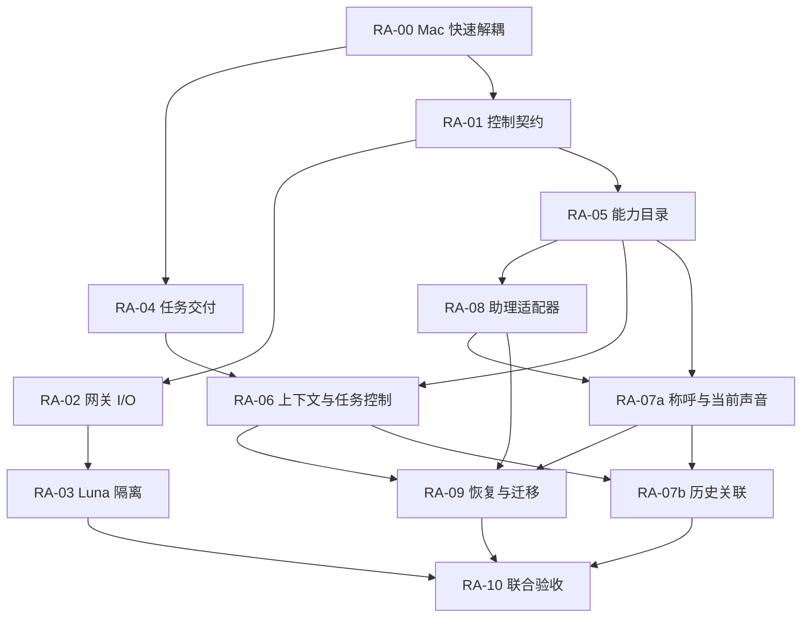

# 随时回应：分步实施计划

日期：2026-11-25。总 issue：[#36](https://github.com/JasonGuoo/esp-bot/issues/36)。基线：`46ecdfbd99eba8e9158f8953b9ca251a45bc1d92`。**M0（RA-00 与 #35）已实现并完成主机测试，待实板验收。RA-01～RA-10 仍待实现，相关实板验收均未运行。**

本计划建立在现有 HC 实现上，优先修复控制和交付边界，再把已存在的功能接成能力。各步的具体代码位置、接口、失败策略和回归见独立规格，不在旧 HC issue 中重复声称已完成。

## 1. 依赖与交付顺序

图示为主依赖；下表列出完整直接依赖。可以提前按冻结接口并行开发，集成验收必须满足对应依赖。

| 步骤 | 直接依赖 | 用户可见交付 | 建议代码范围 | 合并边界 |
| --- | --- | --- | --- | --- |
| [RA-00](steps/ra-00-quick-decoupling.md) | 无 | 后台任务不再占住下一轮；待补参任务不再把闲聊推给 OpenCode | `gateway/segments.rs`、`gateway.rs`、`fast_core.rs::route`、orchestration | 仅 Mac；使用既有 final 段契约；无协议/固件变更；一个开关可回滚。#35 steer 修复并行单独提交 |
| [RA-01](steps/ra-01-control-contracts.md) | RA-00 | 输入、停止、后台操作和输出的归属明确 | 控制状态/事件契约、既有 runtime 映射 | 可测试的 reducer 与有界接纳；保持旧协议适配 |
| [RA-02](steps/ra-02-gateway-io.md) | RA-01 | TTS、PCM 尾包、DB 或网络慢时仍可控制 | `brain/gateway.rs`、gateway 子模块、存储/媒体适配 | 分批迁出分支，旧路径受开关控制；不同时重写全部网关 |
| [RA-03](steps/ra-03-luna-worker.md) | RA-01、RA-02 | Luna 慢或卡住时仍可停止、补充和发起新输入 | `brain/fast_core.rs`、orchestration、worker、`server/xiaodai-core` 适配 | 模型请求/会话所有权与控制循环分开；不粗暴删除顺序锁 |
| [RA-04](steps/ra-04-task-delivery.md) | RA-00 | 交给小呆长任务后仍能普通聊天 | `gateway/segments.rs`、TaskService、持久结果收件箱 | 当前回答完成与任务完成分开；不能只删 busy 条件 |
| [RA-05](steps/ra-05-capability-registry.md) | RA-01 | 助理知道哪些能力当前可用，动作有真实操作 ID | 拟议 capability registry/dispatch、快核心结构化提案 | 先 typed registry 与测试适配器，再逐项开放真实动作 |
| [RA-06](steps/ra-06-context-and-task-control.md) | RA-04、RA-05 | 记得相关任务，能问进度、取消、补参与改要求 | 上下文快照、TaskService、模型提示/动作绑定 | 只读查询先行；运行中改要求按适配器支持的版本语义开放 |
| [RA-07a](steps/ra-07-identity-continuity.md#ra-07a称呼与当前声音) | RA-05、RA-08（名字校验） | 很晚才说“我是 Jason”：称呼立即保存、可靠的当前声音绑定、查询/更正/遗忘 | identity adapter、bot-server 名字校验器、voice_album | 复用既有晚命名与 11-18 声音匹配称呼；不做历史回认 |
| [RA-07b](steps/ra-07-identity-continuity.md#ra-07b历史关联) | RA-07a、RA-06 | 有证据时把以前的匿名对话关联到此人 | 历史回查 workflow、来源修订、Graphiti 传播 | 单独验收；不阻塞 M2；不默认开启留存 |
| [RA-08](steps/ra-08-assistant-adapters.md) | RA-05（记忆的上下文部分另依赖 RA-06） | 记住/纠错/遗忘、提醒和设备控制自然可达 | memory/reminder/device 等 typed adapters | 分能力小 PR，每项必须完成自然入口到实际结果的路径 |
| [RA-09](steps/ra-09-recovery-and-migration.md) | RA-04、RA-06、RA-07a、RA-08 | 重连、跨天、重启以后状态仍可解释和继续 | inbox/operation 恢复、schema 迁移、来源清理与核对 | 不假定所有 running 任务能重跑；未知外部效果先核对 |
| [RA-10](steps/ra-10-validation-and-rollout.md) | RA-00～RA-09、RA-07b | 在用户 Mac/S31 上逐项开放已验证体验 | 本地回归、TLA+、验收记录与启用策略 | 分别记录源码、模型检查、本机执行和实板结果；无 CI |

**建议顺序（按 PR #37 review 调整）：** RA-00（及并行的 #35 修复）→ RA-04 持久收件箱与结果交付策略 → RA-01/RA-02 以 strangler 方式在 RA-00 接缝后抽出 → RA-03；RA-05 只依赖 RA-01，提醒与记忆适配器（RA-08）先于身份；RA-07a 进入 M2，RA-07b 之后单独验收。RA-04 与 RA-01 可在 RA-00 后并行；RA-08 的提醒部分只需 RA-05 与 `memory/proactive.rs`，不必等待 RA-06 的完整快照投影器。RA-04 早期的存储调用经受限 blocking 执行域运行，RA-02 再统一迁入存储 worker。RA-09 汇总恢复验证，**每步自身的数据结构、迁移和故障恢复不能延后到 RA-09 才实现**。RA-10 是联合场景验收，每步的实现回归与形式化更新仍随对应行为 PR 交付。

## 2. 每个步骤的详细规格必须回答

1. 用户在什么时刻说什么，设备已经播出/保存了什么，成功后应看到什么。
2. 哪个组件拥有状态，哪些输入由宿主注入，哪些字段仅由模型建议。
3. 涉及哪些现有文件，哪些是拟新增文件；拟议 API、数据库字段和协议位与已存在实现明确区分。
4. 正常路径、取消、重复消息、迟到结果、过载、重连和服务失败如何处理。
5. received、accepted、committed、applied、delivered 的证据各是什么；未知效果如何表示。
6. 所需的迁移、旧端降级、开关、回滚及不可撤销效果边界。
7. TLA+ 的状态、有限边界、不变量和有条件进展性质，以及触发真实实现的回归入口。
8. 本步骤实际执行过哪些检查、未执行什么；未运行的验收记录保持 `not_run`。

## 3. 四个集成里程碑

### M0：快速解耦（RA-00、#35）

**状态：implemented, host-tested, pending board acceptance。**

仅 Mac、无协议与固件变更：委派回复以真实 final 段结束本轮，后台任务不再使普通输入返回 session_busy；待补参任务不再强制闲聊走 OpenCode；三处分支内等待先 fence 后迁出。用既有分阶段计时对比前后；#35 steer 竞争单独修复。开关是 `brain.json` 的 `responsive.quick_decouple`，默认 `true`；设为 `false` 恢复基线。任务记录仍在 `TaskService`。开关打开时，结果和补问在下一次设备主动发起的轮次里先说出来（设备处于 COMMITTED），不在空闲时推送；没确认的段不会一直占住前台。App 控制台不再显示 `waiting_task`。跨会话、断线之后的持久交付仍是 RA-04，本步不新建收件箱。主机回归已跑；S31 与真人验收未跑。

### M1：交互可用性（RA-04、RA-01～RA-03）

必须演示 Luna 永不返回、TTS 慢、网络背压、PCM 不齐、数据库锁等待等条件下的控制路径。触摸停止立即使旧输出失效；不以取消清理完成作为用户看见停止的前提。任务 ACK 或本轮内容播完且所需回执齐全后，以既有 `purpose=final` 内容段的真实硬件回执释放本轮（`turn.response_closed` 推迟为可选的后续细化，见 RA-04 §2），允许新一轮按设备许可进入，原任务不丢失；ACK 单独完成不能擅自开启追问。

本里程碑不依赖语音声学打断完成；使用当前可靠的触摸/本地控制入口和半双工基线。真正的首音、停止到 DAC 静音时间另做实板测量。

### M2：可通过对话使用的助理（RA-05、RA-08、RA-06、RA-07a）

至少完成以下自然表达的适配回执闭环：

- “刚才那件事做到哪了 / 不要做那个了 / 再加一个要求”。
- “记住，我是 Jason”，包括已聊过多次、声音暂不确定和历史无证据。
- “以后回答短一点 / 那条不是我说的 / 忘掉这件事”。
- “明早提醒我…… / 取消那个提醒”，具体时间或对象确实缺失时仅问必要问题。
- “太吵了 / 调低音量 / 你现在能做什么”。

固定本地命令继续走低延迟路径。模型提案只能请求已注册且适用的能力；底层存在但不可用的模块不得出现在“现在能完成”的清单中。

### M3：可持续、可恢复（RA-09、RA-07b、RA-10）

断线完成的任务进入持久收件箱；重启恢复先核对真实状态；跨午夜保留任务关联。人物更正/遗忘传播到上下文与派生索引；重试不能带回被撤回的数据。真实终态、结果已保存和已交付分别可查。

有外部效果的任务不追求无条件自动重跑。打印等已提交效果在结果不明时保持 `unknown` 并核对；失败或取消也不能伪称外部效果已撤销。

## 4. 迁移、开关与兼容纪律

- RA-01 定义内部契约，不能凭文档字段直接改变现有 WSS v3。需新增线上语义时，在 RA-02/04 明确协商位和旧端行为；未协商不开启依赖新协议的体验。
- 保存既有 RuntimeToken、来源修订、output lease 和硬件播放回执的含义。不同层的 turn ID 不得静默混用。
- 功能开关、迁移编号与默认值由各实现 PR 按当时 schema 冻结；本文不捏造已存在的配置项或未占用的版本号。
- 新读模型可以从权威记录重建；持久操作、任务结果和删除意图必须保留，不能用清空数据库作为回滚。
- 回滚优先停止接纳新能力调用并保留只读状态与效果核对；不能因为回退模型路由而重复执行已有动作。
- 存储提交失败时可继续本地互动，但不能把仅放入内存队列的工作称为已可靠接纳。

### 4.1 固件预算与刷写

S31 app 分区在 2026-11-18 各阶段之后只剩约 34 KB 余量（当时额外的离线失败语音已放不下）。[AGENTS.md](../../../AGENTS.md) 规定只刷 app 分区，保留配网、模型与数据分区，保持设备音量。因此每个实现 PR 必须写明：是否改固件、估算体积增量、实测 `idf.py size` 结果，以及仅 Mac 的替代做法。默认优先仅改 Mac；M0、M1 计划为零固件改动。

| 步骤 | 固件改动 | 预算上限（估算） | 仅 Mac 的做法 |
| --- | --- | --- | --- |
| RA-00 | 无 | 0 KB | 全部在 Mac 完成 |
| RA-01 | 无 | 0 KB | 宿主内部契约 |
| RA-02 | 原则上无；如回执语义须变更，仅最小适配 | ≤ 4 KB | 保持现有 v3 回执语义，新语义只在 Mac 内部区分 |
| RA-03 | 无 | 0 KB | — |
| RA-04 | M1 无（使用既有 final 段）；可选 `turn.response_closed` 另估 | 0 KB；可选项 ≤ 4 KB | 委派说明作为真实 final 内容段 |
| RA-05、RA-06、RA-07a、RA-07b | 无 | 0 KB | — |
| RA-08 | 设备控制复用既有本地命令与回执；“有结果待取”提示优先复用现有表情 | 0 KB；如须新增表情 ≤ 2 KB | 由 Mac 选择现有表情状态 |
| RA-09、RA-10 | 无 | 0 KB | — |

累计超过 8 KB，或任一步超出其上限，须先经 owner 决定（例如是否启用存储分区），不能悄悄压缩其他功能。不在 app-only 刷写之外改动分区表。

## 5. 形式化与实现验证

每个步骤都列出模型影响。既有 `ListeningGate`、`UtteranceCommit`、`ReplyTiming`、`Supplement`、`TurnPlayback`、`ConversationClose` 保持已有验证范围；新增控制与操作行为需要在首次实现时补充模型。统一对应表见[验收规范](acceptance.md)。

控制进展性质不假设 Luna、数据库或网络必定完成；可以假设本地控制执行环境仍被调度。业务完成性质则必须写明其依赖的后端、存储或设备健康条件。TLC 的有限状态检查不证明真实毫秒延迟、识别准确性或用户听感。

沿用 `tools/check-tla-twins.sh` 与现有实现回归入口。没有合适运行环境时，交付可审阅源码和模型并准确记为未运行；不增加 CI 或为文档工作安装模型/刷机。

## 6. 进度与 issue 管理

本期以 [#36](https://github.com/JasonGuoo/esp-bot/issues/36) 为单一总跟踪，RA-00 与十步规格提供可直接拆出的实现 PR 边界。本次不额外创建十个重复子 issue；后续需要分工时，可按 RA 编号建单并链接对应规格。

| 记录对象 | 本次状态 | 何时可改变状态 |
| --- | --- | --- |
| 总结、框架选择与代码审查 | 已完成本次文档核查 | 代码基线或上游边界变化时更新 |
| 本组设计、RA-00 与十步 specs | 已编写，待 PR 审阅 | 文档 PR 合并后标记设计已合并 |
| RA-00 实现与 #35 steer 交接 | implemented, host-tested, pending board acceptance | 主机 `cargo test` / `cargo clippy` 与 `SteerHandoff` TLC 已跑；实板未跑 |
| RA-04 实现 | implemented, host-tested, pending board acceptance | 主机任务库、网关回环与 `TaskDelivery` / `TurnPlayback` TLC 已跑；实板未跑 |
| RA-01～RA-03、RA-05～RA-10 实现 | 待实现 | 对应行为代码与必要模型/回归实际交付 |
| 运行、延迟、声纹、Mac/S31 联合验收 | `not_run` | 在记录环境中执行并附证据 |

文档 PR 使用 `Refs #36`，不用自动关闭关键词。以后源码完成但实板未验收时继续明确“开发完成，待测试”，不能从勾选文档推导运行通过。旧 issue 的修复和验收状态不被本计划覆盖。
