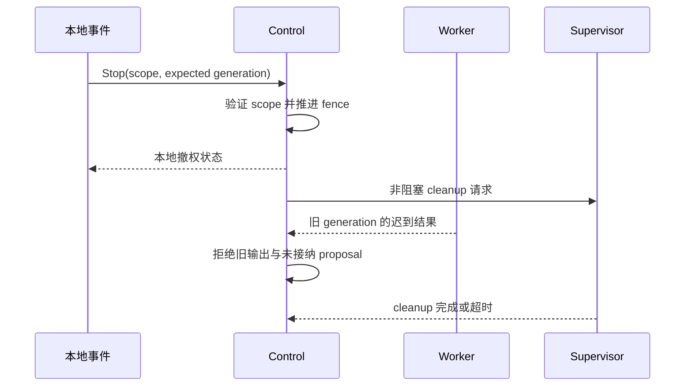

# RA-01：控制契约、版本隔离与有界调度

**状态：待实施；本文件是规格，未新增运行代码或 TLA 文件，未运行本步骤测试。日期：2026-11-25。** [总规格与 issue](../README.md) · [目标架构](../architecture.md)。核对基线：`46ecdfbd99eba8e9158f8953b9ca251a45bc1d92`。

## 目标与依赖

**依赖：无。** 本步骤定义后续 gateway、Luna、任务与能力共同使用的事件、状态和执行契约。交付一个有界的纯 reducer 及其本地 runtime 适配；暂不迁移完整业务，也不新增 Agent runtime。

验收重点是：模型永久不返回、dispatch 满载或 cleanup 不完成时，控制仍能处理 Stop、撤权、连接变化和本地状态。这里的“能处理”是调度与状态转移性质，不是承诺 OS 级硬实时，也不是承诺无后端时理解任意自然语言。

## 源码落点

| 文件 | 当前职责 / 拟议改动 |
| --- | --- |
| [`brain/contracts.rs`](../../../../server/bot-server/src-tauri/src/brain/contracts.rs) | 复用已有 `SourceRef`、`RuntimeBinding`；版本化扩展，避免出现第二个同名来源类型 |
| [`brain/mod.rs`](../../../../server/bot-server/src-tauri/src/brain/mod.rs) | 接线 control runtime 生命周期；不把 service shutdown 的等待放回 reducer |
| [`brain/gateway.rs`](../../../../server/bot-server/src-tauri/src/brain/gateway.rs) | 先增加旧事件→新 envelope 的适配接缝；实际 I/O 迁移属于 RA-02 |
| [`brain/worker.rs`](../../../../server/bot-server/src-tauri/src/brain/worker.rs) | 将现有 generation/取消信息映射到统一契约；不把全局取消作为所有领域的通用动作 |
| **拟议新增** `server/bot-server/src-tauri/src/brain/control_contracts.rs` | `EventEnvelope`、foreground/operation/output 引用、dispatch 与可信回执类型 |
| **拟议新增** `server/bot-server/src-tauri/src/brain/control.rs` | `reduce(state, event) -> Transition`，有限状态、权限与输出仲裁规则；没有 I/O |
| **拟议新增** `server/bot-server/src-tauri/src/brain/control_dispatch.rs` | 有界 mailbox、非阻塞投递、过载结果及累计 Stop/fence 适配 |
| **拟议新增** `server/bot-server/src-tauri/src/brain/control_runtime.rs` | 顶层事件选择、有限批次、公平调度、本地计时器与 background supervisor 接缝 |
| **拟议新增** `formal/tla/macos/ResponsiveControl/` | 同名 `.tla`、`.cfg`、`checks.sh`，实际创建属于实现 PR |

新增文件可以在实现 review 后合并成更小模块，但职责和接口不得因此消失；变更需同步本规格。具体派生字段以[架构的统一 envelope](../architecture.md#5-统一事件版本与可信来源)为准。

## 接口与状态

### 1. 纯决策与执行必须分离

拟议 `Transition` 返回 `next_state`、有限数量的 `effects`、可选 `visible_state` 和观测计数。reducer 不持有 `Brain`、provider、数据库、socket 或异步锁，不执行日志网络回调；输入和输出均有类型与大小上限。

runtime 的顶层可以 `select`/等待事件。每次事件处理只做有限工作：校验 envelope、变更状态、`try_dispatch`、发布不可变快照。`try_dispatch` 返回 `Enqueued / Full / Closed`；失败必须再变成 reducer 可处理的结果。不得使用 `send().await` 等待队列空位，也不得在失败后无限追加到隐藏 `VecDeque`。

同步数据库、JSON/PCM 大对象转换、文件及 CPU 密集工作放到有并发上限的工作线程/进程。单纯将阻塞函数放进 Tokio task 不能通过本步骤的隔离验收。

### 2. 统一引用

| 类型 | 字段 / 语义 |
| --- | --- |
| `EventEnvelope` | `event_id, request_id?, service_epoch, origin, origin_seq, foreground?, operation?, output?, deadline_mono?, payload` |
| `ForegroundRef` | `connection_epoch, activation_id, runtime_token, turn_id, generation, input_revision`；字段由宿主绑定 |
| `OperationRef` | `operation_id, operation_revision, task_id?`；持久 operation 不随 foreground 自动结束 |
| `OutputRef` | `output_lease_id, playback_id, segment_seq`；只有当前 lease 可产生新的呈现 |
| `ActionProposal` | 模型可提交 `capability_id, parameters, target_handle?`；不是执行权限 |
| `TrustedActionContext` | 宿主填充 `request_id, service_epoch, source, actor_scope, policy_epoch, snapshot_version, catalog_version, foreground?, operation?, output_lease_id?`；mutation/workflow 必需 operation，query_snapshot/query_local 可空 |

`SourceRef` 复用现有类型。capability adapter 由宿主解析受限 `audio_ref`；模型不能提供任意音频路径、source revision、授权、幂等键或正式人物绑定。任务修改使用独立的 `expected_task_revision`；它与 `operation_revision` 及 `ForegroundRef.generation` 不等价。

可信回执至少区分下列事实，具体业务状态由 RA-05 冻结：

| 事实 | 可对用户作出的陈述 |
| --- | --- |
| `received` / 本地已解析 | “已收到”；不能说已开始工具或已经保存 |
| `enqueued` | 工作已进入有界执行队列；仍非 durable admission |
| `read_result` | query_snapshot 返回权限合法缓存的 `snapshot_version/source_refs/as_of/stale`；query_local 返回有界本地观察的来源和采样时刻；不宣称未核实的外部事实 |
| `accepted_durable` | 持久接纳成功，带真实 operation/task ID 和版本 |
| `applied` | 存储/能力的效果已证实；不能自动等同呈现完成 |
| `cancel_requested` | 已请求取消；不能说远端副作用已撤销 |
| `cancelled` | 对应执行边界已证实取消，保留真实已发生效果 |
| `failed` / `unknown` | 已知失败 / 效果不明，后者需要 reconcile，不盲重试 |

同一 request 的回复可迟到、重复或与 Stop 交错。未接纳的旧 proposal 被丢弃；已持久接纳的 operation 按自身版本继续。提交与取消跨越存储边界时，记录实际获胜的 commit/取消证据；不能仅依据内存 token 宣称数据库或外部系统没有执行。

只读 task/device/capability 状态采用 `execution_class=query_snapshot`：按 request ID 关联，`received → read_result`，不写 `assistant_operations`，不要求 `accepted_durable`，不等待 DB。缓存未知或过旧要如实返回；权限撤回不能因缓存旧而被绕过。`query_local` 采用同一只读回执规则，只接经审计的有界宿主观察，例如 `clock.now` 读取系统时钟和授权时区，不等待网络校时、DB 或其他 I/O；不能把任意“本地库调用”都标为此类。精确时间字段由 RA-08 定义，并与本进程 monotonic deadline 分开。这样数据库忙时仍可解释最近已知状态，mutation/workflow 的 commit-before-accepted 则保持不变。

### 3. 控制优先级和容量

拟议通道分为：独立 Stop/撤权快照、有限终态/回执 mailbox、普通业务 mailbox、可合并的观测/UI、独立媒体 ring，以及各 worker 的有界命令队列。实施配置须列明每连接/家庭/worker 的对象数、字节数和待处理计时器上限。

Stop 使用按已接纳活跃 scope 预留的撤权状态；同 scope 累积最大代际，不同 scope 不能互相覆盖。若用 `watch`，其值必须是累积 snapshot，不能是容易覆盖上一条的单个 `StopEvent`。service shutdown 具有独立的只进不退 latch。任务取消是有 ID/版本的持久 mutation，不能塞入会合并丢失的瞬时 Stop 通道。

Stop/fence 在每个有界处理批次前检查；普通输入和终态也有获得调度的配额。控制风暴不能无限分配内存，正常业务也不能因无限循环排空控制队列而永久饥饿。消息积压上限和拒绝原因必须可观察。

### 4. 撤权与清理的顺序

`output.stop` 只撤当前输出；`turn.cancel`/supplement 撤前台 generation；`task.cancel` 改持久任务；service shutdown 关闭接纳并撤全部输出。远端 ACK、worker join 或 DB flush 均不能成为 fence 生效的前置条件。supervisor 可以带 deadline 等待回收，超时后记录受影响资源、未知效果和恢复计划；不得无限积累“等回收”的句柄。

本地单调 deadline 不保存为跨重启有效时间，不与用户提醒时间或设备单调时间混算。新 service epoch 默认使旧 output lease 不可执行。

## 实现清单

- [ ] 建立上述 typed envelope、受限负载和 ID/version 校验；给不适用的 scope 明确 `None` 语义，避免填假 turn ID。
- [ ] 写纯 reducer，覆盖当前 foreground/input/output 子状态及 Stop 范围；将 task 状态视为外部已确认事实。
- [ ] 为每类 effect 定义容量、`Full/Closed` 行为、保留槽与丢弃/合并规则；持久最终结果只传引用，不能靠临时 mailbox 唯一保存。
- [ ] 建有限 dispatcher：重试有上限，拒绝不生成假 accepted receipt，关键清理按 scope 累积，不偷偷转无界队列。
- [ ] 建 supervisor 接口，先 fence 后 cleanup；cleanup deadline 与执行额度独立于交互接纳。
- [ ] 将 reducer/dispatch 的 CPU、分配、每批事件数量纳入预算；UI、音频、模型执行域不在同一阻塞调用栈中。
- [ ] 添加结构化观测：当前 epoch、队列深度/字节数、溢出、事件年龄、fence→cleanup 完成、拒绝旧结果计数；不记录原始私人 PCM。
- [ ] 审计隐含的 `Drop`/析构、日志 sink 和跨模块回调，不能借由“同步小函数”在 control 内等待 provider 或清理；大对象只传受限引用。
- [ ] 在现有入口旁加入版本适配，不在本步悄悄重写 provider 路由、TTS 策略或固件收音许可。
- [ ] 建 TLA twin、TLC 配置和调用真实 reducer/dispatcher 的 `checks.sh`，更新 formal 索引。

## 必须覆盖的案例

| 类型 | 输入/故障 | 预期 |
| --- | --- | --- |
| 正常 | 事件→effect 入队→当前版本结果 | 当前状态推进；事实回执与输出权限分别验证 |
| 失败 | worker 永不返回，另一个连接收到有效 Stop | Stop 不依赖 worker 结束；状态/本地反馈继续，语义结果仍标未知或等待 |
| 取消 | 旧结果先排队，Stop 被处理后该结果才出队 | 按当前 fence 拒绝，不能因“已入队”获得豁免 |
| 取消 | 一个 output.stop 与另一 activation 的 Stop 紧邻到来 | 两个 scope 都撤权，不能被 watch 最后一条覆盖 |
| 过载 | 普通 mailbox、worker 命令队列与 cleanup 额度同时耗尽 | 新工作明确 overload；Stop 仍可推进 fence；内存/句柄有界 |
| 事实竞争 | 持久提交与取消交错、提交回执晚到 | 以 operation ledger/revision 区分已提交、已取消、未知；不自动重复提交 |
| 恢复 | 旧 service epoch 在重启后回调 | 不获得当前输出权；耐久结果由持久 ID reconcile，不借旧 runtime 复活 |

## 形式模型与实现回归

拟议模型：`formal/tla/macos/ResponsiveControl/ResponsiveControl.tla`，同目录 `.cfg` 与 `checks.sh`。模型至少含两个 foreground generation、两个 scope、有限队列、一个永不返回的 backend 和一个延迟 cleanup。

| 拟议性质 | 实现回归要点 |
| --- | --- |
| `NoStaleAuthority` | Stop 后旧输出/未接纳 proposal 不能获 lease；generation、来源与 operation 域混用会失败 |
| `FenceBeforeCleanup` | 用永不完成的 cancel/join 替身，立即观察本地 fence 与后续事件处理 |
| `BoundedQueues` | 填满各通道，检查容量和字节数、溢出事件、没有隐藏无限缓冲 |
| `ReceiptTruthfulness` | 仅收到/入队不能转为 durable accepted、applied 或 cancelled |
| `StopScopePreserved` | 不同 scope 的撤权都保留，task 独立于 output stop |
| `ControlProgress` | 假设本地 scheduler 持续获得运行机会，控制请求最终处理；不假设模型或网络返回 |

真实实现回归置于新增模块的测试或现有 Rust 测试组织中，使用可控 pending futures、受限队列、可控单调时钟；不能只测试伪造 reducer 输出。TLC 不能证明实际线程不会阻塞，另需源代码审查与故障注入。按[formal 规范](../../../../formal/tla/README.md)使用本机 `./tools/check-tla-twins.sh macos/ResponsiveControl`，不添加 CI。

## 兼容、迁移与回滚

新 envelope 首先作为宿主内部契约；WSS v3 的既有字段不直接被替换。旧 runtime token 由 adapter 校验后映射；未携带新协议 capability 的设备维持旧路径。

实现时新增调度配置应明确为新字段、默认关闭或仅用于受控切换，RA-10 验收后再决定默认启用。shadow 模式只比较状态决策，不发送工具、保存身份或重复播报。回滚时停止新接纳、推进 fence、异步回收后切旧路径；durable operation 的真实事实不能随回滚删除或重放。

## DoD 与运行状态

- [ ] 契约、状态所有权、队列满策略、Stop 范围与所有 timeout 域有具体实现映射。
- [ ] reducer 无外部等待；dispatcher 不等待队列空位；block/CPU worker 有并发上限。
- [ ] 永不返回后端、过期结果、多 scope Stop 和满载案例调用真实实现通过。
- [ ] TLA/TLC、`checks.sh` 与受影响旧模型的证据分开记录；代码 review 指出模型未覆盖的线程/硬件假设。
- [ ] 迁移开关与 rollback drill 可重复；未引入第二套任务或 Agent runtime。

**当前运行状态：以上全部待实施、待运行。** 本次文档检查不等于 TLA、Rust、线程隔离或设备响应验收。
