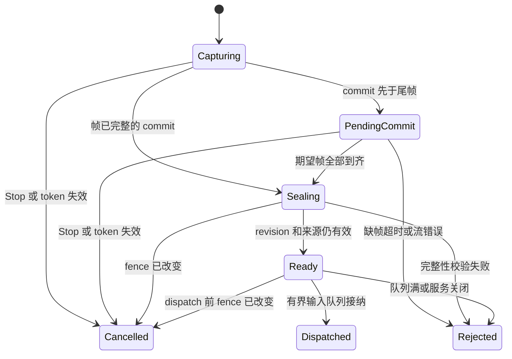

# RA-02：网关 I/O 隔离与非阻塞语音提交

**状态：待实施；本文件是规格，未改运行代码，未运行本步骤测试。日期：2026-11-25。** [总规格与 issue](../README.md) · [目标架构](../architecture.md)。源码基线：`46ecdfbd99eba8e9158f8953b9ca251a45bc1d92`。

## 目标与依赖

**依赖：[RA-01](ra-01-control-contracts.md)。** 将 gateway 中的控制决策与连接读写、PCM drain、存储、素材准备、producer cleanup 分开。设备控制事件不因同连接的模型、数据库或发送阻塞而停止处理。

本步不调整语义模型，也不开放播放中收音。设备本地 Stop 仍由 `bot_runtime` 执行；网络阻塞时，不承诺远端消息已经送达设备。

## 当前问题与源码落点

| 文件 | 当前证据 / 拟议改动 |
| --- | --- |
| [`brain/gateway.rs`](../../../../server/bot-server/src-tauri/src/brain/gateway.rs) | `serve_peer` 分支内有 `send().await`、`finish_plain_input(...).await`、`TurnTask::stop().await`、warmup/prepare 与同步 task/memory 读写；拆成事件适配及薄 lifecycle |
| [`brain/plain_audio.rs`](../../../../server/bot-server/src-tauri/src/brain/plain_audio.rs) | 复用已协商独立 PCM 连接，入出队、断线与超时改用有界事件回报 |
| [`brain/media.rs`](../../../../server/bot-server/src-tauri/src/brain/media.rs) | 保留帧序号、stream、字节/时间上限和 candidate ASR 失效规则；增加可事件驱动的完整性查询 |
| [`brain/gateway/segments.rs`](../../../../server/bot-server/src-tauri/src/brain/gateway/segments.rs) | `Delivery::new/next/report` 当前直接读写 task/memory DB；将预备/持久回执作为异步 effect，生命周期进一步拆分属于 RA-04 |
| [`brain/acks.rs`](../../../../server/bot-server/src-tauri/src/brain/acks.rs)、[`brain/worker.rs`](../../../../server/bot-server/src-tauri/src/brain/worker.rs) | warmup/取消只在独立执行域等待；维持单实例、idle-only、停止后不复活 |
| [`shared/mac-brain-v3.md`](../../../../shared/mac-brain-v3.md) | 更新拟议 transport/queued/accepted/recorded 回执边界和新增 capability 的协商；不直接重释旧字段 |
| [`brain_secure.c`](../../../../firmware/components/brain_link/brain_secure.c)、[`bot_runtime.c`](../../../../firmware/components/bot_runtime/bot_runtime.c) | 保留 capture sealing、audio fence 和本地 Stop；协议改变时做最小适配及相应回归 |
| **拟议新增** `server/bot-server/src-tauri/src/brain/gateway/io.rs` | 独立 reader、writer、bounded egress、网络 deadline 与连接关闭事件 |
| **拟议新增** `server/bot-server/src-tauri/src/brain/gateway/pending_commit.rs` | 有界 `PendingCommit`、事件驱动 PCM 完整性与接纳状态 |
| **拟议新增** `formal/tla/protocol/GatewayDispatch/` | 同名模型、配置与真实 gateway 回归入口 |

应先列出 `serve_peer` 的完整调用图：不仅搜索 `.await`，也检查同步 SQLite/锁、编码、素材读取和事件 sink。不能只移动 `turn_with()`，它当前已经在 spawn 的 producer 中运行。

## 接口与时序

### 1. reader / writer / control 分开

拟议 reader 完成认证后的帧读取、大小限制、基础解析及 transport source 标记，向 control 投递 RA-01 envelope；大媒体块走独立缓冲。认证/握手也有连接数、字节数和 deadline 上限，不占已激活控制循环。

writer 独占 socket sink，从有限控制/业务/媒体 egress 选择下一个**满足依赖的**帧，执行网络写入并报告 `WriteCompleted / WriteFailed / WriteTimedOut`。manifest、segment、PCM start/end 和回执依赖不得被优先级任意重排。控制不直接调用 socket send。

Stop、连接失效与撤权在独立通道中先推进本地 fence，再通知 writer 丢弃未发送旧代际帧。控制回执可优先于尚未开始的普通媒体写入，不能打断一次已交给 TCP 的 write；因此每帧大小及每次写 deadline 都必须有上限。

若 writer 持续不可写，关闭/隔离该连接并产生明确 transport 失败。reader 和本地 reducer 的处理能力仍应可观察，不能为等失败通知也排入已满的同一个 egress 队列。reader 断线、writer 断线或凭据撤销应幂等推进同一 connection fence。

### 2. PendingCommit 状态

拟议每个有效 capture 最多存在一个 `PendingCommit`：

| 字段 | 约束 |
| --- | --- |
| `request_id`, `foreground`, `stream_id` | 与当前 activation、runtime、input revision 完全绑定 |
| `expected_frames`, `received_frames` | 来自已校验 commit 声明与有序 PCM；不能用收到的较少帧数修改期望值 |
| `capture_ref`, `candidate_revision` | 有界媒体引用；预 ASR 仅在来源和完整范围一致时复用 |
| `deadline_mono`, `state` | 本进程截止点；状态为 waiting_frames / sealing / ready / rejected / cancelled |

`PendingCommit` 只是暂存已解析的提交请求，不能提前发出代表完整语音接纳的 `turn.accepted`。同一 request 的重复 commit 幂等返回相同状态；不同声明/不同 revision 不得合并。pending 期间的额外 PCM 必须仍属于同一 stream 且不超过声明，出现缺口、重复、超额、倒退或来源冲突就显式失败。

PCM 接收、deadline、disconnect、cancel 均产生事件。媒体到齐后的 WAV/base64 构造和存储在 worker 中执行，返回 `CaptureSealed` 时再次核对版本。新音频使预识别候选失效的旧规则保留；已经 commit 的范围不能偷偷扩展为新语句。

capture 的本地封口仍须满足[最新语音 review](../../../review-voice-interaction-2026-11-20.md)要求：runtime/VAD/输入修订/PCM callback in-flight 的一致性、VAD 尾部等待、无锁内阻塞队列操作。Mac 事件化不替代固件的原子封口。

### 3. 存储、回执与 cleanup 也要异步

现有 `Delivery::next()` 的 lease/source/cleanup 检查、`record_receipt`、`journal_receipt`、任务查询和 reminder claim 都是潜在数据库等待。拟议改为有限存储命令及返回事件；控制只保存当前有效权限/版本快照和 pending request 状态。

从设备收到 `presentation.segment.report` 时先校验 runtime/lease/segment/sequence，再派发真实回执写入。若协议回复使用 `recorded`，必须等持久写入事件后才发；如仅表示内存收到，应使用明确的新语义并经协商。等待某条回执入库只是该交付状态 `receipt_persist_pending`，不能让 reducer 等 DB。源修订/撤权事件在内存先 fence，执行端在提交时再核对权威版本。

Stop 的返回表示本地 scope 已撤权。provider interrupt、候选 ASR 回收、ACK warmup join、socket close 和落库在 supervisor/worker 进行。保留 warmup 的单实例、非排队首句 TTS 通道和 Stop 后不得自行恢复；“控制不等 join”不等于取消后放任后台任务失控。

## 队列与过载规则

| 队列/资源 | 满载后的明确行为 |
| --- | --- |
| 普通控制输入 | 拒绝新普通请求或关闭不合规连接；已知 Stop/撤权仍走保留通道；不得无界缓存原文 |
| writer 控制/终态槽 | 保留必要终态；无法维持协议时使连接失败并撤 lease，不能静默丢“最终完成”后仍标成功 |
| writer 普通/UI | 合并同 scope 的未显示瞬时状态；不合并副作用回执或任意重排呈现段 |
| 输入 PCM | 使用原有字节/时间上限和 transport 流控；不可继续时显式终止该 capture，不伪装成安静录音 |
| 输出 PCM | 有界预取；媒体发送不能占普通控制槽；终止时记录 partial/failed 与实际设备位置 |
| PendingCommit / sealing | 每 capture 一个、每连接/全局有限；超额新 capture 明确拒绝；timer 和 buffer 同步回收 |
| 存储与 cleanup | 有限 worker 和 pending ledger；Full/Closed 回到 control；Stop 本身不能被这两个队列阻挡 |

## 实现清单

- [ ] 建立 I/O 调用图并记录所有同步/异步等待；为每处标明迁移目的地和取消所有者。
- [ ] 拆分 reader/writer，避免共享 socket 所有权迫使读操作等待写锁；设置每连接和全局接纳上限。
- [ ] 构造 typed transport events，严格保留 connection/runtime/stream/generation 与 request ID，拒绝重复/旧帧。
- [ ] 实现 `PendingCommit` 及有限 timer；替换 `finish_plain_input(...).await` 的控制内补帧循环。
- [ ] 将 encoding、素材读取、WAV 构造、storage/lease/receipt 调用移出 reducer；保留处理结果的二次 freshness 检查。
- [ ] 将 `TurnTask::stop().await` 等 join 移到有 deadline 的 supervisor；先撤权再提交清理。
- [ ] 补齐独立 Stop/撤权、控制 writer 保留槽、媒体背压、queue-full 和断线事件，且都可观测。
- [ ] 保持 negotiated PCM transport；失败、ACK 后正文失败不偷偷降级为未协商 WSS binary audio。
- [ ] 把回执语义写入 WSS 协议及 capability；旧客户端返回格式与新版内部事件使用明确 adapter。
- [ ] 更新 `GatewayDispatch`、`UtteranceCommit` 及受影响 `TurnPlayback`/`Supplement` 模型与真实 loopback 回归。

## 正常、失败、取消与过载案例

| 案例 | 可观察结果 |
| --- | --- |
| WSS commit 先到，最后两帧稍后到 | 进入 PendingCommit；其他控制事件继续；到齐才封存和接纳一次 |
| commit 等尾帧时用户触摸 Stop | 设备本地停；Mac 收到后撤 pending token，不等 PCM；迟到帧不能生成新轮 |
| writer 被对端停止读取卡住 | 控制状态、reader 与本地 Stop 继续；发送 deadline 后断线；不声称消息已播放 |
| SQLite 被长事务占住 | 回执保存/任务接纳保持 pending 或明确失败；控制继续，不发假的 recorded/accepted |
| PCM 缺序号、超量、断线或超过 deadline | 给 transport/commit 错误；不计成空输入自动重试，不把残缺音频送成完整语句 |
| UI/progress 风暴填满队列 | 可合并中间状态；Stop、终态和真实媒体失败仍有处理路径 |
| 重复 commit、重复 receipt、新 epoch 收旧帧 | 幂等处理或拒绝；不会双执行、提前下一轮或替旧 lease 换新 token |
| ACK 后正文失败 | 保留协商音频连接/格式与明确 partial；失败文案不立即被无关状态清掉 |

## TLA 与实现回归

拟议 `formal/tla/protocol/GatewayDispatch/GatewayDispatch.tla` 描述有限 control/data 队列、可阻塞 writer、两个 token、PCM 尾帧乱序到达和 Stop。实现回归必须使用真实 reader/writer/dispatcher 与进程内 loopback socket，不能仅用立即完成的 mock send。

| 拟议性质 / 关联模型 | 必须回归的真实风险 |
| --- | --- |
| `ControlIndependentOfWrite` | 阻塞 socket sink 时仍能处理有效 Stop 和其他本地事件 |
| `BoundedIngressEgress` | control/media/cleanup 同时满载，内存和 pending/timer 不继续增加 |
| `CommitAfterDeclaredFrames`，既有 `UtteranceCommit` | commit 早于尾帧；少帧/多帧/错误 stream/Stop/旧 candidate 均不能错误接纳 |
| `NoStaleTransportAuthority`，既有 `TurnPlayback` | 旧 connection/token/lease 不能推进新轮，网络已发送不等于设备已播放 |
| `FenceBeforeJoin`，RA-01 `ResponsiveControl` | provider 与 producer cleanup 不返回时，控制 fence 先完成 |
| 既有 `Supplement`、`ReplyTiming` | 显式补话与 ACK warmup 的所有权不被 I/O 拆分破坏 |

保留/扩展 [`gateway.rs` 现有回环与边界测试](../../../../server/bot-server/src-tauri/src/brain/gateway.rs)：认证拒绝、runtime lease、实际播放计数、一次空输入重试、图像块归属。实板还需验证 capture-ready、音频尾部、touch Stop 和半双工；本机 socket 测试不证明声学打断效果。

计划命令为 `./tools/check-tla-twins.sh protocol/GatewayDispatch` 及受影响现有模型；模型配置与 `checks.sh` 同实现提交，不新增 CI。[formal 入口](../../../../formal/tla/README.md)。

## 固件预算

本步原则上不改固件：Mac 内部区分 transport/queued/accepted/recorded，线上保持现有 v3 回执语义。若确需固件适配，须先估算并实测体积（上限约 4 KB），只刷 app 分区；见[实施计划 §4.1](../implementation-plan.md#41-固件预算与刷写)。

## 兼容、迁移与回滚

先切内部 reader/writer 和存储适配，保持现有 v3 可观察语义；新 pending/receipt/foreground 事件仅在能力协商后启用。缺失协商的旧端可以继续旧行为，不能仅因 Mac 有新内部状态就收到无法理解的完成事件。

`audio.pause`、既有 PCM transport、token-bound sealing、owner 音量和被动唤醒边界保持。回滚停止新请求、fence 活跃 lease、把待确认效果留在 ledger，再切旧入口。不能让新旧 writer 同时持有一个 socket，也不能双消费 PCM。切换中的断线应显式失败而非自动重放旧语音。

## DoD 与运行状态

- [ ] 完整调用图中每个等待都有 worker/IO/supervisor 所有者；control 不触碰同步 DB、网络或 join。
- [ ] PendingCommit 到齐、取消、超时、重复、错误序号及 queue-full 均有明确终态和资源释放。
- [ ] 阻塞真实 writer、占住 SQLite、卡住 cleanup 的故障注入下，control 仍处理事件，旧输出不能复活。
- [ ] 既有封口、空输入重试、失败音频协商、不可变回执和半双工测试保留。
- [ ] 新协议 capability、旧端适配、切换/回滚与所有容量列入实际实现记录。
- [ ] 对应 TLC/实现回归完成；实板项单独报告，不能用本机结果代替。

**当前运行状态：全部待实施/待运行；没有宣称网关已拆分或已通过响应性测试。**
