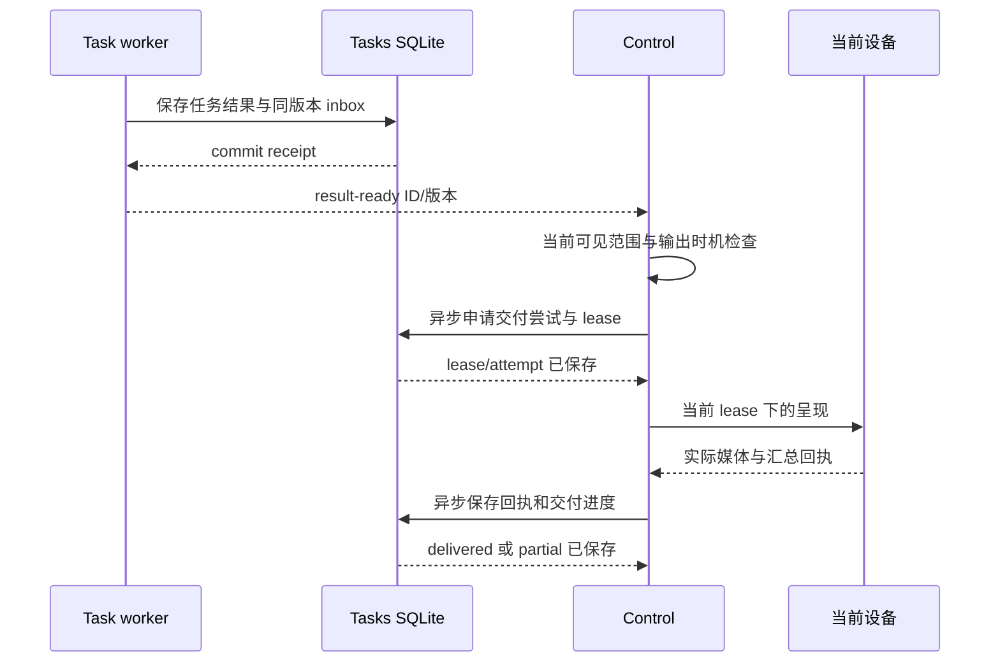

# RA-04：前台轮次、持久任务与结果交付分离

**状态：待实施；仅规格，未改任务/协议/固件运行代码，未运行本步骤测试。日期：2026-11-25。** [总规格与 issue](../README.md) · [目标架构](../architecture.md)。核对基线：`46ecdfbd99eba8e9158f8953b9ca251a45bc1d92`。

## 目标与依赖

**依赖：[RA-00](ra-00-quick-decoupling.md)（按 review 调整；早期存储调用经受限 blocking 执行域，[RA-01](ra-01-control-contracts.md)/[RA-02](ra-02-gateway-io.md) 完成后再迁入统一存储 worker）。** 让后台任务继续执行时，前台轮次能以明确的回答/委派结果结束，用户能再提问题；任务结果可靠保留，在适当的当前输出许可下交付。此步骤不依赖 RA-03 才能定义生命周期；现有 OpenCode/任务 producer 也使用同一契约。

现有 [`TaskService`](../../../../server/bot-server/src-tauri/src/brain/tasks.rs) 已有独立任务、SQLite、并发上限、进度和效果证据。本步扩展它，不建立另一套 job scheduler。用户日记录、activation、turn、task、结果与 lease 的独立性必须真正贯穿 gateway 和设备协议。

## 当前耦合与源码落点

[`Delivery`](../../../../server/bot-server/src-tauri/src/brain/gateway/segments.rs) 当前包含 `tasks: VecDeque<String>`，`next()` 的 final 与 `report()` 的结束判断都要求 tasks 为空；[`gateway.rs`](../../../../server/bot-server/src-tauri/src/brain/gateway.rs) 又在 ordinary input 时把 `delivery.is_some()` 作为 session_busy。因此需要一起改接纳、producer 完成、呈现回执和任务结果恢复。**只删除一个 `tasks.is_empty()` 条件不满足本规格。**

| 文件 | 拟议改动 |
| --- | --- |
| [`brain/tasks.rs`](../../../../server/bot-server/src-tauri/src/brain/tasks.rs) | 在现有 SQLite 增加 task/result revision 与 delivery inbox；终态/需补充问题和 inbox 原子保存；所有 control 调用经存储执行域 |
| [`brain/presentation.rs`](../../../../server/bot-server/src-tauri/src/brain/presentation.rs) | 明确 foreground response、task result、delivery attempt 与 output lease/receipt 的关联 |
| [`brain/gateway/segments.rs`](../../../../server/bot-server/src-tauri/src/brain/gateway/segments.rs) | `Delivery` 缩为一次有界呈现尝试；移除其作为后台任务容器的职责，保留必需媒体回执 |
| [`brain/gateway.rs`](../../../../server/bot-server/src-tauri/src/brain/gateway.rs) | 新输入的 busy 仅由真实前台/音频接纳条件判定；去除“等所有后台任务”的前台计时/polling 责任 |
| [`brain/orchestration.rs`](../../../../server/bot-server/src-tauri/src/brain/orchestration.rs)、[`brain/capabilities.rs`](../../../../server/bot-server/src-tauri/src/brain/capabilities.rs) | TaskAccepted/需要补充/结果通过现有执行器进入新事实契约；不直接夺取设备输出 |
| [`brain/contracts.rs`](../../../../server/bot-server/src-tauri/src/brain/contracts.rs) | 复用来源及 runtime binding；新增关联通过 RA-01 类型定义，避免 task ID 与 turn token 混用 |
| [`shared/mac-brain-v3.md`](../../../../shared/mac-brain-v3.md)、[`brain_secure.c`](../../../../firmware/components/brain_link/brain_secure.c)、[`bot_runtime.c`](../../../../firmware/components/bot_runtime/bot_runtime.c) | 协商前台委派完成边界；保持设备真实播放/显示、音频尾巴和收音许可 |
| **拟议新增** `server/bot-server/src-tauri/src/brain/task_delivery.rs` | inbox 选择/版本化交付尝试、当前 recipient/lease 校验、结果通知适配；不拥有第二个任务执行器 |
| **拟议新增** `formal/tla/macos/TaskDelivery/` | 同名 `.tla`、`.cfg`、`checks.sh`；同时更新现有 `TurnPlayback` |

RA-06 负责更多 task query/mutate 和快照；RA-09 负责统一崩溃恢复。本步骤必须先具备原子 inbox、版本和重放接口，不能把防丢结果推迟成纯 UI 功能。

## 状态与接口

### 1. foreground response 只承诺本轮答复

拟议 foreground response 独立保存：`turn_id/generation`、producer 是否封口、必需呈现集合、已完成回执、相关 `task_id` 的**引用**以及 `response_outcome`。任务引用不参与前台完成的“是否仍运行”判断。

| `response_outcome` | 进入条件 |
| --- | --- |
| `answered` | producer 封口，当前所需内容、显示、音频和最终呈现的成功回执齐全 |
| `delegated` | 所承诺任务已有 `accepted_durable`，本轮必要 ACK/说明已完成真实呈现，producer 封口；任务可以仍 queued/running |
| `partial` | 有连续、可证明的已呈现内容，但必需后续内容或媒体失败；保存实际边界 |
| `failed` | 无法完成本轮答复，明确失败原因；ACK 成功不将失败改为 answered |
| `cancelled` | 本轮前台已撤权；可能已发生的持久操作单独记录，不能被此值抹去 |

`ProducerClosed` 只终结生成，不表示用户听完。媒体已发送也不表示呈现结束。新普通输入仍须满足当前设备收音/音频 gate；后台 task 数量、旧 turn ID 或昨日日期不能成为 session_busy 的理由。

### 2. 委派完成必须有协议闭环

当前 v3 约定 `task_ack/progress` 播完继续等，只有 `purpose=final` 的汇总完成才进入下一句。[模块契约 §9](../../../module-contracts.md) 已写明“final 内容段可以在独立 Mac 任务仍在处理时完成播放”；耦合在 Mac 代码（`segments.rs:36` 仅在 `self.tasks.is_empty()` 时标 final，`:104` 也以此结束交付），而不在设备契约。

**M1 的主路径（无协议/固件变更）：** 任务获得 `accepted_durable` 后，把本轮 ACK/说明（如“好，我去查，查好告诉你”）作为真实 `purpose=final, final=true` 内容段发送；以该段的硬件回执结束前台，`response_outcome=delegated` 只记录在 Mac 侧；任务不再放入 `Delivery`。回滚只需一个 Mac 开关。

**推迟的可选细化：** 只有出现必须由设备区分 `delegated` 与 `answered` 的具体场景时，才新增经协商的 capability `turn.response_closed`（名称在实现时冻结），表达前台答复的 `answered/delegated/partial/failed/cancelled`，与 task.state 分开；同时须给出固件体积估算（见 §固件预算）。

若启用该事件，它至少绑定当前 runtime/turn/generation、response revision、需要完成的 presentation/lease/segment 与可信回执引用；委派还带已接纳任务的 ID/revision。device 只在对应必需本地媒体已完成、回执关系一致、audio fence 满足时才释放前台/准备追问。事件早于本地硬件完成、旧 token 晚到、重复 final 或失败媒体均不能提前开麦。

ACK/progress 仍不是任务成功或正文 final；不能把 `task_ack.final=true` 当补丁。上述主路径使用的是一段真实的 foreground final 内容，说明“任务已接下，正在继续处理”，把本轮说明结束与工作完成区分；接单写库失败时不得发送此段。未经协商不向任何设备发送新事件。

### 3. TaskRecord 与 operation 的版本

保留现有 TaskState：queued、running、awaiting_input、succeeded、partial、failed、cancel_requested、cancelled、unknown。拟议增加 `task_revision`（每次持久状态/输入变化的 CAS 版本）、`result_revision`（冻结结果/待补问题版本）与 operation 关联。已有 `attempt` 继续描述执行尝试，不替代这些版本。

写操作使用宿主幂等键及 expected revision。`resume` 目前仅接纳 awaiting_input，不能把 running 任务当新任务再 submit 一次；运行中改要求的具体语义由 RA-06 定义。明确 source/权限撤销与取消之间的差别，保留已发生的外部效果证据。

`TaskService` 的 SQLite/scheduler/handler 仍是唯一耐久任务所有者。其查询、submit、claim、set_state、receipt 与同步 source 检查经有限存储执行域运行，不能从 control 直接抓 `Mutex<Connection>`。纯 query 可从合法快照返回 read_result；任务真正入库后才有 accepted_durable。

### 4. 持久结果 inbox

拟议在现有 `tasks.sqlite3` 中增量新增 inbox/结果版本表，不以 gateway 内存通知保存唯一结果。

| 字段 | 规则 |
| --- | --- |
| `delivery_id`, `delivery_revision` | stable ID 与 CAS 版本；同一交付尝试不可被两个消费者同时宣称完成 |
| `task_id`, `result_revision`, `kind` | kind 为 result 或 needs_input；awaiting_input 的补问不是任务成功 |
| `recipient_scope` | 家庭/人物/设备可见范围由 host 决定；当前激活者不自动获得私人结果 |
| `result_ref`, `source_refs` | 冻结结果引用、来源版本和撤回关系；内容更正新增版本，不能暗改已播正文 |
| `state` | pending_delivery、offered、partial、delivered、deferred、invalidated |
| `attempted_output_lease_id`, `playback_id`, receipt refs | 当前/历史播放尝试；不是任务寿命或永久权限 |
| `created_at`, due/expiry 元数据 | 持久墙钟与产品政策；进程内等待仍用单调时钟 |

幂等唯一性以 `(task_id, result_revision, recipient_scope, kind)` 表达，具体数据库编码在实现时冻结。给表行、每个结果引用大小、未交付保留量和通知补扫批次设上限；达到保留容量应在接纳新工作前背压，不先接无处保存结果的任务。已有任务的终态不能因瞬时通知队列满被丢弃。

状态语义：pending_delivery 等待合适机会；offered 仅表示建立输出尝试；partial 记录已交付的连续内容；deferred 等待稍后处理；delivered 需要结果所要求的真实回执；invalidated 由来源/权限/删除等政策撤销。partial/deferred 重试建立新 lease，不重跑原任务；不能把 offered、prepared、sent 直接改成 delivered。

### 5. 事务和通知

此图的箭头表示派发/结果事件，不表示 control await SQLite 或设备。具体 delivery 可以等待自己的持久回执，其他控制/轮次不随之阻塞。

任务终态/awaiting_input 结果、冻结 result revision、inbox 行及 result-ready outbox 在同一 SQLite 短事务内提交。commit 成功后通知丢失，启动/重连/周期性有限补扫可恢复；不能通过重复运行 task “找回结果”。若 `memory/assistant_operations.rs` 在另一数据库，使用其 outbox/reconcile 关联，不能声称跨库原子性。

外部执行已结束但数据库忙/磁盘满时，先是 `result_persist_pending` 执行观察，不能宣称 durable succeeded 或结果已保存。worker 保留受结果大小/并发额度限制的待提交引用并停止继续接入无存储预算的工作；有界重试仍失败就如实报告存储故障。若此时进程崩溃，未提交数据不具备恢复保证，外部效果按证据进入 unknown/reconcile，不能靠重跑副作用恢复“看起来成功”。耐久防丢承诺从事务 commit 成功开始。

成功申请 lease 后，control 仍检查当前 generation/recipient/source。申请期间发生 Stop，返回的旧 lease 不产生输出，后台异步撤销它。完整回执持久成功前，最多记录“已收到设备回执、持久确认中”；不能提前对用户或快照宣称 delivered。

## 发言仲裁和通知政策

同一设备音频资源同一时刻只有一个有效输出所有者。优先级由 control 决定：本地 Stop/撤权最高，其次当前用户互动和合法前台答复；后台结果进入候选交付，不直接调用 TTS/socket 抢话。长结果可以先给有来源的简短说明，再按用户意愿展示全文；摘要本身不等于完整结果全部交付，交付策略需声明用户实际被承诺的内容集合。

默认的结果到达不创建新 activation、不打开麦克风、不突破家庭/人物范围。可在仍然有效的明确互动中适时提示，或等用户下次激活/查询。明确设定的提醒沿现有授权播报和安静/音量/日限额规则，仍不打开 follow-up 收音。不要把“后台工作完成”改造成全天主动打断。

进度必须来自任务/adapter 的真实状态。可以合并重复阶段，但不能编造百分比、搜索次数或“快完成了”。多个任务需要澄清时，使用稳定 task handle，不能让当前 delivery 数组位置决定“刚才那个”。

## Stop、取消和失败

- `output.stop` 立即撤当前输出尝试；inbox 根据真实播放边界转 partial/deferred，任务继续。
- `turn.cancel`/supplement 撤旧前台，尚未接纳的旧提案不得执行；已接纳的持久任务不随 turn 自动取消。
- `task.cancel` 是独立带 ID/revision 的操作，产生 cancel_requested，再按实际 adapter 证据进入 cancelled 或 unknown；打印已送出不等于纸张被追回。
- service shutdown 撤输出并停止接纳；supervisor 有限等待，恢复时审查 tasks/operations/inbox，不重新播放旧 lease。

取消与提交竞争需记录真实 commit 边界。某个后台结果在旧 turn 取消后到达，可以保存为当前任务事实，但不继承旧输出权。不能把所有晚结果都丢弃，也不能因为结果属于真实任务就让它穿过已撤销的 lease。

## 实现清单

- [ ] 将 foreground、task、operation、delivery、lease 分开建类型和状态，删去后台 tasks 对前台 busy/final 的隐式决定权。
- [ ] 在移除耦合前实现 producer_closed、必需媒体集合、真实回执和 response_outcome 的完整判定。
- [ ] 以既有 `purpose=final` 真实内容段结束委派轮次（主路径）；`turn.response_closed` 仅在出现具体需求时另行设计、协商并估算固件体积。
- [ ] 在现有 tasks 数据库增加 revision、冻结结果和 inbox/outbox，迁移保持既有任务、打印证据、来源撤回信息。
- [ ] 修改 TaskService 的结果/awaiting_input 提交，使 task 状态和待交付记录同事务；通知可以重放且不重跑效果。
- [ ] 实现单一 output arbiter 和交付 claim/CAS，lease 只能授予当前有效设备/接收范围，迟到 grant 必须被 fence。
- [ ] 实现 partial/deferred/invalidated 处理及按真实回执保存的边界；区分摘要交付与完整结果承诺。
- [ ] 将 task polling、存储读写、素材恢复和 lease 管理迁出 control；快照/read_result 不等 DB。
- [ ] 定义全部容量、满载接纳策略、保留期限和恢复补扫批次；已接纳任务结果不靠无界临时缓存兜底。
- [ ] 实现任务取消与输出取消各自回执，未知效果进入 reconcile；禁止由 identity 更新或新 turn 隐式 cancel_all。
- [ ] 补 TaskDelivery/TurnPlayback 模型及任务、gateway、固件实际回归；与 RA-06/09 的版本/恢复接口一致。

## 正常、失败、取消与过载案例

| 案例 | 应有结果 |
| --- | --- |
| “帮我查资料”，已接单后又问“树叶为什么是绿的” | 第一轮以 delegated 结束；查资料 task 继续；新问题按当前输入许可进入，与任务未完成无关 |
| 任务瞬间完成，比 ACK 更早返回 | task/result/inbox 先保存；arbiter 避免重复答复或两个 lease 抢话；前台完成按真实必要回执判定 |
| 任务等用户补参数，用户先闲聊 | task 保持 awaiting_input；问题保留 needs_input inbox；闲聊不自动作为任务参数 |
| 用户停止播报时任务完成 | 本地输出停止；结果仍保存 pending/partial/deferred；不借新 lease立即重播 |
| ACK 成功，但任务接纳 DB 写失败 | 不能先说“已安排”；如仅有 received 反馈，解释接纳失败，task 不存在也不伪造 ID |
| 终态事务提交后通知进程崩溃 | 恢复从 inbox 找回结果，不重新执行打印/外部写入 |
| 外部效果已发生，结果入库时磁盘满 | 不声称 durable succeeded/delivered；有界持有待提交结果，记录存储故障，重启后按证据 reconcile |
| 播放了一半后断线/重启 | 保存有证据的连续前缀或 unknown；不标 delivered；新尝试经当前许可重新安排 |
| inbox/任务接纳容量耗尽 | 明确拒绝新工作；现有已接纳任务保留结果通路；control/Stop 继续 |
| 用户换人或午夜，结果后来到达 | task ID 不变；按最新合法 recipient/source 判断交付，不能向不适用的人播私密结果 |
| task.cancel 与真实外部完成同时发生 | 记录完成/取消的实际证据，保留 unknown/reconcile；不让 output.stop 伪装成功撤销 |

## TLA 与实现回归

拟议 `formal/tla/macos/TaskDelivery/TaskDelivery.tla`：两个任务、两个 foreground、两个结果 revision、一个设备、有限 inbox、可丢通知/重连和竞争取消。现有 `protocol/TurnPlayback` 必须扩展 delegated 前台完成，而不是弱化真实硬件回执条件。

| 拟议性质 / 关联模型 | 实现回归 |
| --- | --- |
| `TaskLifetimeIndependent` | 新 turn、Stop、断线和午夜不删除已接纳任务；显式 task.cancel 才改变取消状态 |
| `ResultAndInboxAtomic` | 事务故障注入，不出现终态结果存在但必须交付的 inbox 永久缺失；通知丢失可重扫 |
| `NoDeliveryWithoutCurrentLease` | late grant、旧 playback、错误 recipient/source 不得输出或推进新轮 |
| `ForegroundCompletionIsHonest` | 未封口/缺必需回执不能完成；delegated 不把 task 状态改为 succeeded |
| `DeliveredRequiresReceipt` | offered、sent、ACK 或部分播放不能代替最终交付证据 |
| `NoEffectReplayOnRecovery` | 重连/补扫/重新播报不再次运行 task；不确定外部效果进入 reconcile |
| `BoundedDeliveryWork` | inbox 满、通知满、慢存储时资源有界；已接受任务的结果路径不靠无限内存 |

真实测试需使用临时 SQLite、实际 TaskService、gateway loopback 和故障注入事务。扩展 [`tasks.rs` 既有取消回归](../../../../server/bot-server/src-tauri/src/brain/tasks.rs)及实际输出回执测试；新增 delegated 后普通输入、终态与 ACK 反序、重连查 inbox、旧 token 不开追问、重复 delivery claim、不同 recipient 与来源撤回案例。

在实现 PR 中同步 `.tla`、`.cfg`、`checks.sh` 和 [formal 索引](../../../../formal/tla/README.md)。计划命令 `./tools/check-tla-twins.sh macos/TaskDelivery`、`./tools/check-tla-twins.sh protocol/TurnPlayback`，以及受影响的 Supplement/ListeningGate。TLA 的最终交付活性只在存在合法互动机会、存储和设备继续获得处理机会时成立；用户一直离线时 pending_delivery 是正确状态。

## 兼容、迁移与回滚

数据库采用增量 migration：已有 task 保持原 ID、attempt、effect receipt 与 source；历史结果缺少可靠播放证据时不能推断为 delivered。首次 migration 为可恢复的 terminal/awaiting_input 记录建立去重 inbox，明确既有已删除/失效来源的排除规则，防止迁移后突然大批播报。

新 foreground completion 按设备 capability 启用；旧单次回复与现有 `presentation.segments.v1` 不被悄悄重释。版本混用要覆盖“新 Mac+旧设备”“新设备+旧 Mac”和服务切换中的 pending 交付。

回滚先冻结新接纳并撤本地输出，将未知效果、结果/inbox 保留；旧程序不能解释新行时保持只读/不执行，不删除表或自动回放。切回旧 gateway 不能把所有 pending task 塞回当前 Delivery 占住用户。若无法安全降级，明确停止该交付功能并保留可查询任务事实。

## DoD 与运行状态

- [ ] 后台 task 运行期间，合法新前台输入可用；task 引用不再决定前台 busy/final。
- [ ] task_ack/progress、producer closed、foreground response closed 与 task completed 四种事实可分别观察。
- [ ] device 协商和真实媒体 gate 成立；没有只删除 `tasks.is_empty()` 的捷径。
- [ ] 终态/needs_input 与 inbox 原子保存；notification loss/restart 不丢结果、不重跑副作用。
- [ ] 输出停止、前台取消、任务取消、服务关闭各有正确 receipt，迟到任务结果仍可保存但不能旧 lease 播出。
- [ ] 半双工、recipient/source、quiet/reminder 约束及新旧版本回滚覆盖完整。
- [ ] 对应模型/真实回归完成，实板音频、完整流程与跨日恢复证据分别记录。

**当前运行状态：以上实现、迁移、TLC、回归及实板验收全部待执行。** 本次仅完成设计定义。
